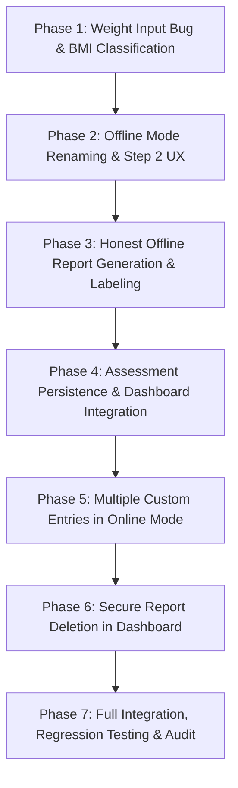

# Afiyat AI — Health Assessment Improvements, Offline Mode, Data Persistence & Report Management
## Master Implementation Plan

**Project:** Afiyat AI  
**Author:** Senior Full-Stack Engineer & Software Architect Team  
**Status:** Audit & Planning Complete — Ready for Sequential Phase Execution  
**Baseline Quality Gates:** 213 / 213 Tests Passing | TypeScript: 0 Errors | ESLint: 0 Errors | Production Build: Verified  

---

## 1. Executive Summary & Audit Findings

### 1.1 Architectural Overview & Data Flow
The assessment flow currently spans:
1. **Frontend UI ([Assessment.tsx](file:///d:/01_Career/01_Agentic%20AI/Health%20Companion%20AI/src/pages/Assessment.tsx)):**
   - Step 1: Body Basics & Biometrics (Age, Gender, Height, Weight, Live BMI calculation).
   - Step 2: Symptoms & Daily Habits (Structured chips, Custom text inputs, Activity, Diet, Substances, Sleep, Hydration).
   - Step 3: Review & Save (Analysis display, BMI hero card, Risk indicators, Actionable habits, Emergency check, Save button).
2. **Services ([healthService.ts](file:///d:/01_Career/01_Agentic%20AI/Health%20Companion%20AI/src/services/healthService.ts)):**
   - `calculateBMI(heightCm, weightKg)`: Evaluates BMI and categorical WHO classification.
   - `analyzeHealthAssessment(record, isDemo)`: Dispatches to Gemini Edge Function `analyze-health` if online; invokes `generateDemoHealthAnalysis(record)` if offline.
   - `saveAssessment(record, isDemo)`: Saves assessment to Supabase `health_assessments` or `localStorage`.
   - `fetchUserAssessments(userId, isDemo)`: Retrieves user assessment history from Supabase or `localStorage`.
3. **Database & Storage ([Supabase](file:///d:/01_Career/01_Agentic%20AI/Health%20Companion%20AI/supabase/COMPLETE_SCHEMA_SETUP.sql)):**
   - Table `public.health_assessments`: Stores `user_id`, `height_cm`, `weight_kg`, `bmi`, `bmi_category`, `symptoms`, `lifestyle_data` (JSONB), `risk_level`, `ai_summary`, `recommendations`, `disclaimer`, `source`.
   - Table `public.report_shares`: Cascade-linked to `health_assessments`.
   - Row Level Security (RLS): Policies for `SELECT`, `INSERT`, `UPDATE`, and `DELETE` with `auth.uid() = user_id` are fully defined.
4. **Dashboard & Reports ([Dashboard.tsx](file:///d:/01_Career/01_Agentic%20AI/Health%20Companion%20AI/src/pages/Dashboard.tsx), [Report.tsx](file:///d:/01_Career/01_Agentic%20AI/Health%20Companion%20AI/src/pages/Report.tsx)):**
   - Dashboard retrieves assessments via `fetchUserAssessments(user.id, isDemo)` and displays history items.
   - Reports are rendered by [ReportView.tsx](file:///d:/01_Career/01_Agentic%20AI/Health%20Companion%20AI/src/components/report/ReportView.tsx).

---

## 2. Root Cause Diagnoses

### 2.1 Diagnosis 1: Weight Input Backspace Bug (Requirement C)
* **File:** [src/pages/Assessment.tsx: Line 664](file:///d:/01_Career/01_Agentic%20AI/Health%20Companion%20AI/src/pages/Assessment.tsx#L664)
* **Code:**
  ```tsx
  const [inputWeight, setInputWeight] = useState<number>(68);
  ...
  <Input
    id="weight-input"
    type="number"
    min="20"
    max="650"
    step="0.5"
    value={inputWeight}
    onChange={(e) => setInputWeight(Math.max(1, Number(e.target.value)))}
  />
  ```
* **Mechanics:** When the user hits Backspace to clear the input, `e.target.value` becomes `""` (empty string). In JavaScript, `Number("") === 0`. The handler computes `Math.max(1, 0) === 1`, forcing the state to `1`. When the user then types `50`, the input receives `5` resulting in `"15"`, and then `0` resulting in `"150"`.
* **Permanent Fix:** Decouple controlled input display state as a string (`const [weightInputStr, setWeightInputStr] = useState<string>("68")`). On change, accept raw string including empty `""`. Derive numeric weight for live calculations via safe parsing (`parseFloat(weightInputStr)`). Enforce boundary validation (20–650) only upon progression to Step 2.

### 2.2 Diagnosis 2: Offline/Demo Assessment Persistence Failure (Requirement E)
* **Files:** [src/pages/Assessment.tsx: Line 415](file:///d:/01_Career/01_Agentic%20AI/Health%20Companion%20AI/src/pages/Assessment.tsx#L415) & [src/services/healthService.ts: Lines 164-169](file:///d:/01_Career/01_Agentic%20AI/Health%20Companion%20AI/src/services/healthService.ts#L164-L169)
* **Mechanics:** 
  1. An authenticated user (e.g. `user.id = "huzaifa-uid"`, `useAuth().isDemo = false`) opens `/assessment`.
  2. The user toggles "Demo Mode" (to be "Offline Mode") on the page, setting local state `localDemo = true`.
  3. Upon completion, `handleFinish` calls `saveAssessment(record, localDemo)`.
  4. In `saveAssessment`:
     ```ts
     if (isDemo || !isSupabaseConfigured) {
       const current = await fetchUserAssessments("demo", true);
       const updated = [fullRecord, ...current];
       localStorage.setItem(DEMO_ASSESSMENTS_KEY, JSON.stringify(updated));
       return fullRecord;
     }
     ```
  5. Because `localDemo === true`, `saveAssessment` dumps the record into browser `localStorage` under dummy user `"demo"`. **It NEVER writes to Supabase.**
  6. The user is redirected to `/dashboard`.
  7. On `/dashboard`, `useAuth().isDemo` is `false` (since the user is authentically logged in). Dashboard executes `fetchUserAssessments(user.id, false)`, querying Supabase directly.
  8. Supabase returns no new record! The assessment was stored in localStorage and is invisible to the user's account.
* **Permanent Fix:** Disentangle **Guest Session (`isDemoUser`)** from **Calculation Mode (`assessment_mode: "offline" | "online"`)**:
  - If a user is authenticated (`user.id` exists and is not a guest demo), ALWAYS persist to Supabase `health_assessments`.
  - Store `assessment_mode: "offline"` and `is_offline: true` inside the schema-compatible `lifestyle_data` JSONB column.
  - Only use `localStorage` when the global auth session is an unauthenticated guest demo (`useAuth().isDemo === true`).

### 2.3 Diagnosis 3: Missing "Severe Thinness" & Category Layout (Requirement B)
* **File:** [src/services/healthService.ts: Line 88](file:///d:/01_Career/01_Agentic%20AI/Health%20Companion%20AI/src/services/healthService.ts#L88) & [src/pages/Assessment.tsx: Lines 694-718](file:///d:/01_Career/01_Agentic%20AI/Health%20Companion%20AI/src/pages/Assessment.tsx#L694-L718)
* **Mechanics:** `calculateBMI` currently has 4 categories: `Underweight (<18.5)`, `Normal weight (18.5 - 24.9)`, `Overweight (25 - 29.9)`, and `Obesity (>=30)`. The spectrum bar in both Step 1 and Step 3 is a 4-column grid.
* **Permanent Fix:**
  - Update `calculateBMI`:
    - `< 16.0`: `Severe Thinness` (Rose/Red treatment, matching Obesity alert weight)
    - `16.0 to < 18.5`: `Underweight` (Amber treatment)
    - `18.5 to < 25.0`: `Normal weight` (Emerald treatment)
    - `25.0 to < 30.0`: `Overweight` (Amber treatment)
    - `≥ 30.0`: `Obesity` (Rose/Red treatment)
  - Update UI in Step 1 and Step 3 to a 5-column spectrum gauge with category labels stacked above their numerical ranges.

### 2.4 Diagnosis 4: Single Custom Entry Limitation (Requirement F)
* **File:** [src/pages/Assessment.tsx: Lines 798, 915, 977](file:///d:/01_Career/01_Agentic%20AI/Health%20Companion%20AI/src/pages/Assessment.tsx#L798)
* **Mechanics:** Custom symptoms, custom habits, and custom family history are represented by single string states (`customSymptoms`, `customHabits`, `customFamilyHistory`). When a user types something, they can only submit one concatenated string.
* **Permanent Fix:** Transform each into a dynamic multi-entry tag system (`customSymptomsList: string[]`, `customHabitsList: string[]`, `customFamilyList: string[]`). Provide an input with a visible `+` button and `Enter` key handling. Display each entry as a removable chip badge with an `X` icon. Pass the array directly into `compiledSymptoms` and `lifestyle_data`.

### 2.5 Diagnosis 5: Missing Report Deletion in Dashboard (Requirement G)
* **Files:** [src/pages/Dashboard.tsx: Lines 348-382](file:///d:/01_Career/01_Agentic%20AI/Health%20Companion%20AI/src/pages/Dashboard.tsx#L348-L382) & [src/services/healthService.ts](file:///d:/01_Career/01_Agentic%20AI/Health%20Companion%20AI/src/services/healthService.ts)
* **Mechanics:** No `deleteAssessment` function exists in `healthService.ts`. In `Dashboard.tsx`, each history item only has a "View Report" button.
* **Permanent Fix:** 
  - Add `deleteAssessment(id: string, isDemo?: boolean)` to `healthService.ts`.
  - In `Dashboard.tsx`, add an accessible trash/delete icon button with tooltip.
  - Implement a confirmation dialog confirming report ID, date, and destructive action.
  - Cascade deletion is already enforced by Supabase foreign keys (`report_shares.assessment_id ON DELETE CASCADE`).

---

## 3. Seven-Phase Implementation Plan



---

### Phase 1 — Weight Input Backspace Bug & BMI Classification ✅ [COMPLETED & VERIFIED]
- **Status:** Verified (215/215 tests passed, TypeScript clean, ESLint clean, Build successful)
- **Objective:** Fix weight input clearing defect and introduce the "Severe Thinness" category with responsive stacked range labels.
- **Requirements Covered:** Requirement B, Requirement C.
- **Files Involved:**
  - `src/services/healthService.ts` (`calculateBMI`)
  - `src/pages/Assessment.tsx` (Step 1 Weight Input & Step 1/3 BMI Spectrum Gauges)
  - `src/services/healthService.test.ts`
- **Implementation Steps:**
  1. Refactor `inputWeight` state in `Assessment.tsx` to use string representation (`weightInputStr: string`) with clean empty-string handling on Backspace.
  2. Implement safe parsing and min/max validation (20–650) on Step 1 submission.
  3. Update `calculateBMI` in `healthService.ts` to classify `< 16.0` as `"Severe Thinness"` and `16.0` to `< 18.5` as `"Underweight"`.
  4. Update `getBmiBadgeColor` in `Assessment.tsx` to give "Severe Thinness" a prominent red warning treatment (`bg-rose-50 text-rose-800 border-rose-300 font-bold`).
  5. Refactor Step 1 and Step 3 BMI gauges to a 5-column spectrum (`Severe Thinness (<16.0)`, `Underweight (16.0–18.4)`, `Normal (18.5–24.9)`, `Overweight (25.0–29.9)`, `Obesity (≥30.0)`).
  6. Place numerical ranges cleanly underneath category labels with a responsive grid.
- **Dependencies:** None.
- **Testing:**
  - Add unit tests for `calculateBMI(180, 48)` -> `bmi: 14.8`, `category: "Severe Thinness"`.
  - Add boundary tests: `15.9` (Severe Thinness), `16.0` (Underweight), `18.5` (Normal).
  - Verify weight input Backspace and typing `50` does not produce `150`.
- **Quality Gates:** `npm run test`, `npx tsc -p tsconfig.app.json --noEmit`.

---

### Phase 2 — Offline Mode Renaming & Conditional Step 2 UX ✅ [COMPLETED & VERIFIED]
- **Status:** Verified (215/215 tests passed, TypeScript clean, ESLint clean)
- **Objective:** Rename all user-facing "Demo Mode" elements to "Offline Mode" and hide custom free-text entries when Offline Mode is active.
- **Requirements Covered:** Requirement A, Requirement D.
- **Files Involved:**
  - `src/pages/Assessment.tsx` (Header Switch, Stepper, Step 2 Custom Inputs)
- **Implementation Steps:**
  1. Rename state `localDemo` to `isOfflineMode` in `Assessment.tsx`.
  2. Update header switch: Label `"Offline Mode"`, description `"Deterministic • Rule-Based"`.
  3. Update Stepper: Step 3 label dynamically displays `"Review & Save"` when in Offline Mode and `"AI Review & Save"` when in Online Mode.
  4. Ensure switching steps (1 <-> 2 <-> 3) strictly preserves the selected mode.
  5. Conditionally hide or disable custom symptom input, custom substance input, and custom family history input when `isOfflineMode === true`.
  6. Add a subtle, clean helper text in Offline Mode: *"Offline mode evaluates standardized structured indicators without cloud AI processing."*
  7. Preserve all structured chips, options, and toggle states.
- **Dependencies:** Phase 1.
- **Testing:**
  - Verify mode toggle preserves state between Step 1, Step 2, and Step 3.
  - Verify custom inputs disappear in Offline Mode and reappear in Online Mode.
- **Quality Gates:** `npm run test`, `npx tsc -p tsconfig.app.json --noEmit`.

---

### Phase 3 — Honest Offline Report Generation and Labeling ✅ [COMPLETED & VERIFIED]
- **Status:** Verified (215/215 tests passed, TypeScript clean, ESLint clean)
- **Objective:** Verify deterministic rule-based evaluation in Offline Mode without cloud AI calls, and prominently display the Offline Mode banner.
- **Requirements Covered:** Requirement A, Requirement E (part 1).
- **Files Involved:**
  - `src/pages/Assessment.tsx` (Step 3 Review screen & `handleProceedToStep3`)
  - `src/services/healthService.ts` (`generateDemoHealthAnalysis`)
  - `src/types/report.ts` (ReportData schema)
  - `src/components/report/ReportView.tsx` (Offline banner)
- **Implementation Steps:**
  1. In `handleProceedToStep3`, when `isOfflineMode === true`, call `generateDemoHealthAnalysis(draftRecord)` directly. Do NOT invoke `analyzeHealthAssessment` (Gemini Edge Function).
  2. In Step 3 Review screen, when in Offline Mode, display title `"Health Analysis & Recommendations"` (NOT "AI Health Analysis").
  3. Add the prominent **OFFLINE MODE** banner:
     - Badge: **OFFLINE MODE**
     - Text: *"Rule-Based Result — Not AI-Analyzed. This report was generated using the application's offline rules. An AI model did not analyze your responses, and the result may be less personalized than an AI-assisted assessment."*
     - Permanent medical notice: *"This is not a medical diagnosis."*
  4. Update `ReportDataSchema` in `src/types/report.ts` with `isOffline?: z.boolean().optional()`.
  5. In `ReportView.tsx`, render the same prominent Offline Mode banner at the top of Section 1 if `report.isOffline === true`.
- **Dependencies:** Phase 2.
- **Testing:**
  - Verify zero network calls to `analyze-health` Edge Function during Offline Mode evaluation.
  - Verify banner presence and wording on review screen and report view.
- **Quality Gates:** `npm run test`, `npx tsc -p tsconfig.app.json --noEmit`.

---

### Phase 4 — Offline Assessment Persistence and Dashboard Integration ✅ [COMPLETED & VERIFIED]
- **Status:** Verified (216/216 tests passed, TypeScript clean, ESLint clean)
- **Objective:** Resolve the false-success persistence defect so offline assessments are genuinely saved to the authenticated user's account in Supabase.
- **Requirements Covered:** Requirement E.
- **Files Involved:**
  - `src/services/healthService.ts` (`saveAssessment`, `fetchUserAssessments`)
  - `src/pages/Assessment.tsx` (`handleFinish`)
  - `src/pages/Dashboard.tsx` (Assessment History List)
  - `src/services/reportService.ts` (`buildReportData`)
- **Implementation Steps:**
  1. Refactor `saveAssessment` in `healthService.ts`:
     - Disentangle `isDemoUser` (unauthenticated guest) from `isOfflineMode`.
     - When `user.id` is present and `isDemoUser === false`, write to Supabase `health_assessments`.
     - Save `assessment_mode: "offline"`, `is_offline: true`, and `analysis_engine: "deterministic_rules"` inside `lifestyle_data` (JSONB).
  2. In `Assessment.tsx`, call `saveAssessment` with authenticated user context while tagging `isOfflineMode`.
  3. Ensure toast `"Assessment Successfully Saved"` only displays after `saveAssessment` Promise resolves successfully; if an error occurs, catch and display explicit error message.
  4. In `Dashboard.tsx`:
     - Inspect `item.lifestyle_data?.assessment_mode` in Assessment History.
     - Display an `"Offline Mode"` badge alongside `"Categorical Risk"` for offline assessments.
  5. In `reportService.ts`:
     - When `buildReportData` parses an assessment where `lifestyle_data?.assessment_mode === "offline"`, set `report.isOffline = true`.
- **Dependencies:** Phase 3.
- **Testing:**
  - Complete an Offline assessment as a logged-in user and verify Supabase table `health_assessments` receives the row with `lifestyle_data.assessment_mode = 'offline'`.
  - Navigate to `/dashboard` and verify the assessment appears in history with the Offline Mode badge.
  - Click "View Report" and verify the report loads with the Offline banner intact.
- **Quality Gates:** `npm run test`, `npx tsc -p tsconfig.app.json --noEmit`.

---

### Phase 5 — Multiple Custom Entries for Online Assessments (Completed & Verified)
- **Objective:** Replace single-entry inputs with a dynamic multi-entry tag system (`+` button, Enter key, removable badges).
- **Requirements Covered:** Requirement F.
- **Files Involved:**
  - `src/pages/Assessment.tsx` (Step 2 Custom Inputs & `handleProceedToStep3`)
  - `src/services/healthService.ts` (Type definitions)
- **Implementation Steps:**
  1. Refactor custom state in `Assessment.tsx`:
     - `customSymptomsList: string[]`
     - `customHabitsList: string[]`
     - `customFamilyList: string[]`
  2. Implement an accessible tag input component/helper:
     - Text input + visible `+` button.
     - `onKeyDown`: When pressing Enter, call `addItem()` and call `e.preventDefault()` to prevent unintended form submission.
     - Validation: Trim string, reject empty/whitespace-only, ignore duplicate entries.
     - Tag display: Render added items as removable badge chips with an `X` button and `aria-label="Remove [item]"`.
  3. Compile all items into assessment payload:
     - `compiledSymptoms = [...selectedSymptoms, ...customSymptomsList]`
     - `lifestyle_data.family_history = [...selectedFamilyConditions, ...customFamilyList]`
     - `lifestyle_data.harmful_substances = [...selectedSubstances, ...customHabitsList]`
  4. Verify mobile responsiveness and tag wrapping.
- **Dependencies:** Phase 4.
- **Testing:**
  - Add 3 custom symptoms using both Enter and `+` button.
  - Verify form does not submit on Enter.
  - Verify items can be deleted individually.
  - Verify empty and duplicate items are rejected.
- **Quality Gates:** `npm run test`, `npx tsc -p tsconfig.app.json --noEmit`.

---

### Phase 6 — Secure Report Deletion in Dashboard (Completed & Verified)
- **Objective:** Add safe, confirmed deletion of saved assessment reports from the Dashboard.
- **Requirements Covered:** Requirement G.
- **Files Involved:**
  - `src/services/healthService.ts` (`deleteAssessment`)
  - `src/pages/Dashboard.tsx` (History table, delete button & confirmation dialog)
  - `src/services/healthService.test.ts`
- **Implementation Steps:**
  1. Implement `deleteAssessment(assessmentId: string, isDemo = false): Promise<void>` in `healthService.ts`:
     - If `isDemo`: filters and updates `localStorage`.
     - If authenticated: calls `supabase.from("health_assessments").delete().eq("id", assessmentId)`.
  2. In `Dashboard.tsx`, add a Delete action (trash icon `Trash2`) to each history item.
  3. Implement an accessible Confirmation Dialog using Radix Dialog / shadcn AlertDialog:
     - Shows report date and title.
     - Warning: *"This action permanently deletes this assessment report and any active shared links."*
     - Actions: `Cancel` and `Delete Report` (destructive red).
  4. On confirm, trigger `deleteAssessment`, display success toast, and refresh local assessment list.
  5. Handle empty state gracefully if all assessments are deleted.
- **Dependencies:** Phase 4.
- **Testing:**
  - Unit test for `deleteAssessment`.
  - Integration test verifying deletion removes record from Supabase and cascade-removes share links.
  - Verify dashboard updates immediately without page reload.
- **Quality Gates:** `npm run test`, `npx tsc -p tsconfig.app.json --noEmit`.

---

### Phase 7 — Full Integration, Regression Testing & Documentation (Completed & Verified)
- **Objective:** End-to-end user journey validation across online and offline flows, mobile layouts, and quality gate sign-off.
- **Requirements Covered:** All requirements integration.
- **Files Involved:**
  - Entire application test suite
  - `docs/AFIYAT_AI_REDESIGN_PLAN.md` & `README.md`
- **Implementation Steps:**
  1. Full end-to-end audit:
     - Online assessment with multiple custom entries -> AI review -> Save -> View -> Delete.
     - Offline assessment -> Rule-based review with banner -> Save -> View with banner -> Delete.
     - Weight input Backspace and boundary tests.
     - Severe Thinness BMI verification.
  2. Mobile responsiveness verification on 375px, 768px, and 1280px.
  3. Accessibility audit (visible focus, ARIA labels on delete/add/close buttons, contrast).
  4. Run all quality gates:
     - `npm run test` (all 213+ tests pass)
     - `npx tsc -p tsconfig.app.json --noEmit` (0 errors)
     - `npm run lint` (0 errors)
     - `npm run build` (successful production bundle)
  5. Update documentation.
- **Dependencies:** Phases 1 through 6.
- **Quality Gates:** Complete verification clean run.

---

## 4. Regression & Medical Safety Checklist

| Category | Guardrail / Rule |
| :--- | :--- |
| **Medical Safety** | Mandatory disclaimer *"This is not a medical diagnosis"* must remain visible on all screens and reports. |
| **Emergency Detection** | Deterministic red flag checks (`emergencyDetector.ts`) must remain active in both online and offline paths. |
| **Honest Branding** | Offline reports must NEVER be described as AI-analyzed, AI-reviewed, or AI-generated. |
| **Data Privacy & RLS** | All Supabase queries must strictly enforce `auth.uid() = user_id`. No `USING (true)` bypasses. |
| **Zero Regressions** | Baseline of 213 unit tests must never drop. Zero TypeScript errors allowed. |

---

## 5. Sequential Execution Protocol

In strict accordance with user directives:
1. **Initial Run (Current):** Read-only audit and master plan creation only. Zero application source modifications.
2. **Subsequent Runs:** Implement exactly **ONE phase at a time** upon explicit user instruction (`"go"` or `"implement"`).
3. **Phase Sign-Off:** Execute all quality gates, report files changed and test results, and halt to await user confirmation.
