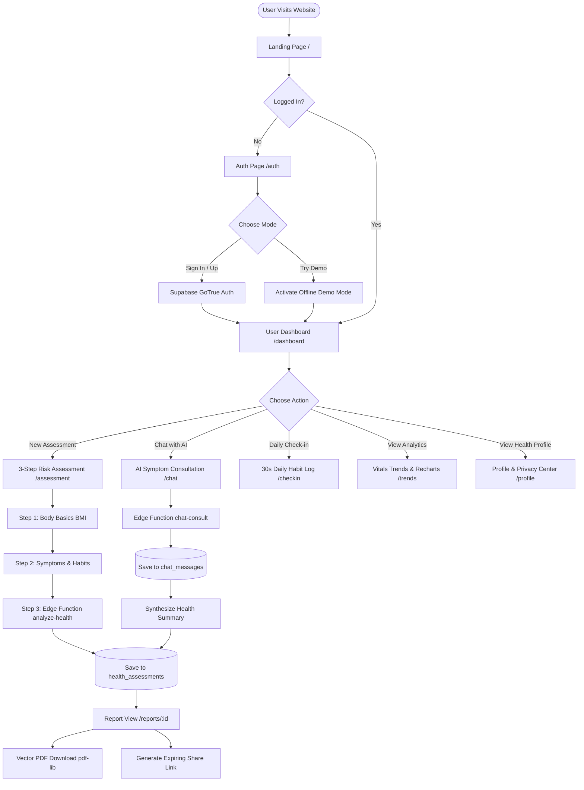
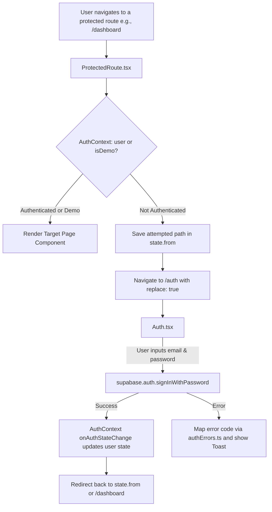
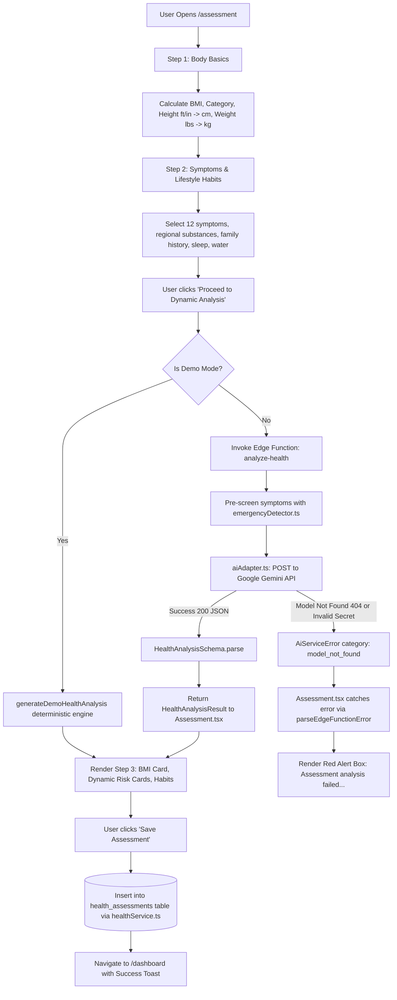
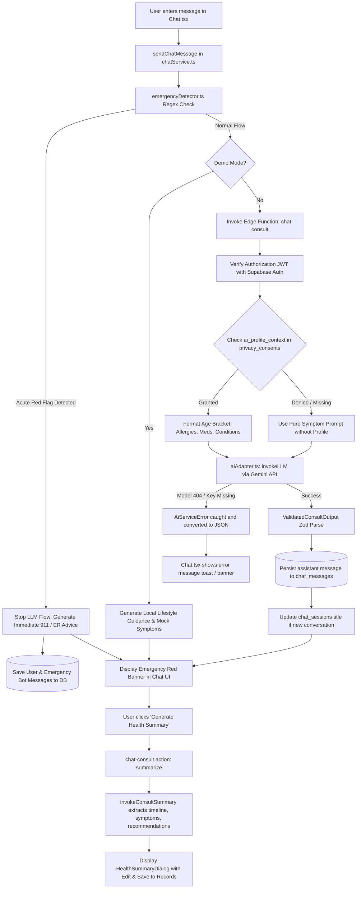
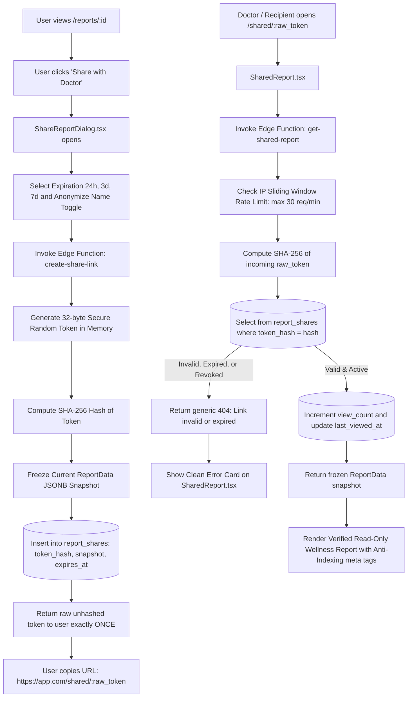
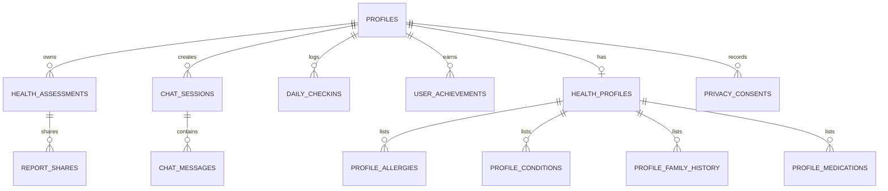

# Health Companion AI — Complete Project Understanding, Codebase Audit & Learning Notes

---

## 1. Project in 60 Seconds

* **What it is:** **Health Companion AI** is a production-grade, patient-facing health and wellness web application designed as a scalable startup product.
* **Core Value:** It gives everyday users a safe, empathetic, and structured way to understand their biometrics (BMI), evaluate wellness risk patterns (`Low`, `Medium`, `High`), log daily lifestyle habits, converse with an AI symptom consultation assistant (in English and Roman Urdu), and export tamper-evident, doctor-ready health reports.
* **The Architecture:**
  * **Frontend:** A responsive Single Page Application (SPA) built with **React 18**, **TypeScript (Strict Mode)**, **Vite**, **Tailwind CSS**, and accessible **Radix UI / shadcn/ui** components.
  * **Backend & Auth:** **Supabase** providing PostgreSQL with strict **Row Level Security (RLS)**, secure authentication via GoTrue JWTs, and isolated serverless **Deno Edge Functions**.
  * **AI Intelligence:** Server-side **Google Gemini API** integration running strictly inside Edge Functions with structured **Zod schema validation**, dual-layer emergency interceptors, and non-diagnostic boundaries.
* **Current Engineering Status:**
  * Milestones **M0 through M4.5 are fully implemented** in code.
  * Baseline test suite: **203 tests across 22 test files** passing cleanly (`vitest run`, 100% pass rate).
  * Strict TypeScript check (`tsc --noEmit`): **0 type errors**.
  * Next planned target: **Milestone 5 (Production CI/CD, Edge Hosting & Startup Launch)**.

---

## 2. Real-World Problem and Proposed Solution

### The Real-World Problem
1. **The "Dr. Google" Trap:** When people experience unusual symptoms (e.g., tension headaches, sudden fatigue, chest discomfort), their default behavior is to search search engines or generic web forums. This typically leads to worst-case panic (cyberchondria), misleading diagnostic claims, or unmonitored self-medication.
2. **Passive Static Content:** Websites like WebMD or Wikipedia provide walls of generic text. They do not know a patient's BMI, sleep deficits, hydration level, or family history, making the advice detached from the individual.
3. **Inefficient Clinical Visits:** Patients frequently visit clinics unprepared—forgetting symptom timelines, failing to correlate habits (e.g., poor sleep or tobacco use) with symptoms, and having only 10–15 minutes with a physician without structured summary notes.

### The Health Companion AI Solution
* **Personalized Context:** Evaluates biometrics (height, weight, BMI), daily lifestyle metrics (sleep hours, water intake, physical activity), and regional habits (cigarettes, Gutka, Paan, Naswar, VELO/ZYN, energy drinks).
* **Empathetic Multilingual Conversation:** Allows users to converse in natural language (English or Roman Urdu) to unpack symptoms step-by-step.
* **Structured Doctor-Ready Summaries:** Automatically synthesizes consultation transcripts into an 8-section wellness summary that users can edit, export to vector PDF with QR verification, or share via temporary, read-only links.
* **Strict Medical Boundaries:** Replaces frightening probabilistic disease guesses with calm, non-prescriptive risk indicators (`Low`, `Medium`, `High`) and immediate red-flag emergency screening.

---

## 3. Product Scope, Users, and Medical-Safety Boundaries

### Intended Users
* **Health-conscious individuals:** People tracking daily wellness habits, hydration, and sleep patterns.
* **Patients preparing for a doctor's visit:** Individuals experiencing mild, vague, or persistent symptoms who need a clear, structured timeline to share with their healthcare provider.
* **Bilingual users:** Users in South Asian or bilingual communities who express symptoms naturally in Roman Urdu (e.g., *"sar me dard hai 3 din se"*).

### Medical-Safety Guardrails (Mandatory & Non-Negotiable)
| What Health Companion AI DOES | What Health Companion AI MUST NEVER DO |
|---|---|
| Calculate deterministic Body Mass Index (BMI). | Diagnose a medical condition (*"You have Diabetes"*). |
| Assign categorical wellness risk tiers: `Low`, `Medium`, `High`. | Output numeric disease probabilities (*"84% chance of Asthma"*). |
| Highlight lifestyle factors (hydration, sleep hygiene, activity). | Prescribe medications, change dosages, or suggest drugs. |
| Suggest questions to ask a licensed physician. | Claim clinical accuracy or replace a licensed doctor. |
| Intercept red-flag emergencies (chest pain, stroke signs) immediately. | Offer false reassurance or delay emergency services. |

> [!IMPORTANT]
> **The Golden Safety Principle:** Every screen, assessment outcome, AI message, and exported PDF displays the mandatory disclaimer:
> *"This is not a medical diagnosis. It is general wellness guidance. Please consult a qualified healthcare professional."*

---

## 4. Overall Application Architecture

```
                                [ User Browser ]
                                       │
                         ┌─────────────┴─────────────┐
                         ▼                           ▼
                 [ Public Pages ]            [ Protected App ]
                 - Landing (/)               - Dashboard (/dashboard)
                 - Auth (/auth)              - Assessment (/assessment)
                 - Shared Report             - Chat Consult (/chat)
                   (/shared/:token)          - Checkin (/checkin)
                                             - Trends (/trends)
                                             - Profile (/profile)
                                             - Reports (/reports/:id)
                                       │
                      [ React Context & TanStack Query ]
                      - AuthContext.tsx (Session state)
                      - Custom Services (API communication)
                                       │
                                       ▼
                         [ Supabase Cloud Platform ]
              ┌────────────────────────┼────────────────────────┐
              ▼                        ▼                        ▼
       [ GoTrue Auth ]        [ PostgreSQL DB ]        [ Deno Edge Functions ]
       - Email/Password       - 16 Relational Tables   - chat-consult
       - Session Persistence  - Strict Row Level       - analyze-health
       - JWT Generation         Security (RLS)         - create-share-link
                                                       - get-shared-report
                                                                │
                                                                ▼
                                                      [ Google Gemini API ]
                                                      - gemini-1.5-flash
                                                      - Structured Zod Output
```

---

## 5. Overall User Journey Flowchart



---

## 6. Complete Feature Inventory

| Module / Feature | Route / Location | Primary Files | Storage / Backend | Verification Status |
|---|---|---|---|---|
| **Marketing Landing Page** | `/` | `src/pages/Index.tsx` | Static UI | Verified Functional |
| **Authentication & Demo** | `/auth` | `src/pages/Auth.tsx`, `AuthContext.tsx` | Supabase Auth + LocalStorage | Verified Functional |
| **Protected Route Guard** | Multiple | `src/components/auth/ProtectedRoute.tsx` | React Router + JWT | Verified Functional |
| **User Dashboard** | `/dashboard` | `src/pages/Dashboard.tsx` | `health_assessments`, `daily_checkins` | Verified Functional |
| **3-Step Risk Assessment** | `/assessment` | `src/pages/Assessment.tsx`, `healthService.ts` | Edge Function `analyze-health` + `health_assessments` | Verified Functional (Requires active model) |
| **Conversational Chatbot** | `/chat` | `src/pages/Chat.tsx`, `chatService.ts` | Edge Function `chat-consult` + `chat_messages` | Verified Functional (Requires active model) |
| **Consultation Summary** | Dialog | `HealthSummaryDialog.tsx` | Edge Function `chat-consult` (`action: summarize`) | Verified Functional (Requires active model) |
| **Daily Wellness Check-in** | `/checkin` | `src/pages/Checkin.tsx`, `trackingService.ts` | `daily_checkins`, `user_achievements` | Verified Functional |
| **Vitals & Habits Analytics** | `/trends` | `src/pages/Trends.tsx`, Recharts suite | `daily_checkins`, `trendAggregation.ts` | Verified Functional |
| **Patient Health Profile** | `/profile` | `src/pages/Profile.tsx`, `profileService.ts` | 5 Profile tables (`health_profiles`, etc.) | Verified Functional |
| **Privacy Center & Deletion** | `/profile` | `PrivacyCenterTab.tsx`, `privacyService.ts` | `privacy_consents`, DB Cascade | Verified Functional |
| **Dynamic Health Reports** | `/reports/:id`| `src/pages/Report.tsx`, `reportService.ts` | `health_assessments` | Verified Functional |
| **Vector PDF Export** | Client-side | `src/services/pdfService.ts` | `pdf-lib` + `qrcode` (In-memory) | Verified Functional |
| **Doctor Share Links** | `/shared/:token`| `src/pages/SharedReport.tsx`, `shareService.ts`| `report_shares` + SHA-256 Hashing | Verified Functional |

---

## 7. Feature-by-Feature Flowcharts

### Flowchart 1: Authentication & Route Protection



### Flowchart 2: 3-Step Health Risk Assessment



### Flowchart 3: AI Symptom Consultation & Summary Synthesis



### Flowchart 4: Doctor Report Sharing & Verification



---

## 8. Project Folder Structure

```
Health Companion AI/
├── .agents/                          # Agent guidelines, operational rules & prompt templates
│   └── rules/
│       └── health-companion-rule.md  # Core project identity, medical safety, and milestone rules
├── docs/                             # Engineering specifications and architecture documentation
│   ├── ARCHITECTURE.md               # Topology, layers, and service responsibilities
│   ├── DEPLOYMENT.md                 # Edge hosting, environment setup, and SPA rewrites
│   ├── M4.5_PLAN.md                  # Milestone 4.5 completed hardening specification
│   ├── PROJECT_AUDIT.md              # Historical discovery report from Lovable decoupling
│   ├── ROADMAP.md                    # Official startup milestone tracker (M0 through M5)
│   ├── ROUTES.md                     # Application route registry and protection status
│   ├── SECURITY.md                   # Threat modeling, encryption, RLS policies, privacy rules
│   └── SUPABASE.md                   # Database schema, table documentation, and Edge secrets
├── public/                           # Static browser assets (icons, robots.txt, sitemap.xml)
├── src/                              # Main application TypeScript source code
│   ├── components/                   # Modular React UI components
│   │   ├── auth/                     # Auth form, demo mode triggers, ProtectedRoute
│   │   ├── chat/                     # Fullscreen chat, suggestion chips, AI diagnostics dialog
│   │   ├── common/                   # Global ErrorBoundary, navbar, footer
│   │   ├── dashboard/                # Vitals cards, assessment logs, quick action shortcuts
│   │   ├── landing/                  # Hero section, feature showcases, trust badges
│   │   ├── profile/                  # Patient details, allergies, conditions, privacy center
│   │   ├── report/                   # Standardized 8-section report, edit dialog, share dialog
│   │   ├── tracking/                 # 30-second daily check-in form, mood selector, today's card
│   │   ├── trends/                   # Recharts suite (BMI, sleep/fatigue, hydration, mood)
│   │   └── ui/                       # Reusable shadcn/ui primitives (Button, Card, Dialog, Toast)
│   ├── context/                      # React Context providers (AuthContext.tsx)
│   ├── hooks/                        # Custom React hooks (useToast.ts, useMobile.tsx)
│   ├── lib/                          # Pure deterministic helper utilities and data transformers
│   │   ├── aiProfileContext.ts       # Privacy data minimization filter for AI prompts
│   │   ├── aiValidation.ts           # Client-side Zod schema validators
│   │   ├── authErrors.ts             # User-friendly mapping of Supabase Auth exceptions
│   │   ├── emergencyDetector.ts      # Regex red-flag and crisis intervention screening
│   │   ├── streaks.ts                # Timezone-resilient calendar streak calculation
│   │   ├── supabase.ts               # Supabase browser client initialization & configuration check
│   │   └── trendAggregation.ts       # Statistical smoothing and non-causal wellness correlation
│   ├── pages/                        # Routable page-level views (Index, Dashboard, Assessment, Chat)
│   ├── services/                     # Business logic and external API/database interaction layers
│   │   ├── aiErrorHelper.ts          # Structured error unpacking and user-facing resolutions
│   │   ├── chatService.ts            # Chat sessions, message history, Edge Function invocation
│   │   ├── healthService.ts          # BMI formulas, assessment persistence, analyze-health caller
│   │   ├── pdfService.ts             # Client-side vector PDF generator with QR verification
│   │   ├── privacyService.ts         # Consent audit logging, JSON archive export, cascade delete
│   │   ├── profileService.ts         # Profile completeness calculation and medical history CRUD
│   │   ├── reportService.ts          # Report synthesis, lifestyle scoring, doctor questions
│   │   ├── shareService.ts           # Token generation, hashing, and link management
│   │   └── trackingService.ts        # Daily check-ins, measurements, and achievement unlocking
│   ├── types/                        # Shared TypeScript interfaces (chat.ts, profile.ts, tracking.ts)
│   ├── App.tsx                       # Application root, React Router configuration, QueryClient
│   ├── index.css                     # Tailwind design tokens, typography, and theme styling
│   └── main.tsx                      # Vite React DOM entrypoint
├── supabase/                         # Backend migrations, configuration, and serverless Edge Functions
│   ├── functions/                    # Deno serverless Edge Functions (executed server-side)
│   │   ├── _shared/                  # Shared Edge utilities (aiAdapter.ts, emergencyDetector.ts, prompts)
│   │   ├── analyze-health/           # Dynamic risk analysis endpoint
│   │   ├── chat-consult/             # Conversational symptom consultation endpoint
│   │   ├── create-share-link/        # Cryptographic share link creation
│   │   ├── generate-doctor-questions/# Physician discussion generator
│   │   ├── get-shared-report/        # Public rate-limited doctor view endpoint
│   │   └── revoke-share-link/        # Instant access revocation endpoint
│   ├── migrations/                   # Sequential PostgreSQL schema migrations
│   └── COMPLETE_SCHEMA_SETUP.sql     # Single-run SQL script provisioning all 16 tables and RLS
├── package.json                      # Dependency declarations and npm build/test scripts
├── vite.config.ts                    # Vite build configuration with @/* path aliases
└── vitest.config.ts                  # Automated test runner configuration
```

---

## 9. Important File Guide

### Application Foundation & Routing

| File Path | Purpose & Responsibilities | Key Symbols / Exports | When to Edit | What to Check / Dependencies |
|---|---|---|---|---|
| `src/main.tsx` | Application entrypoint; mounts React DOM root to `#root`. | `ReactDOM.createRoot` | Only if modifying global CSS imports or root mounting. | Verify `index.html` root div exists. |
| `src/App.tsx` | Configures `BrowserRouter`, `QueryClient`, `AuthProvider`, `ErrorBoundary`, and all route paths. | `App` | When adding, removing, or changing application URLs. | Ensure protected routes are wrapped in `<ProtectedRoute>`. |
| `src/context/AuthContext.tsx` | Tracks logged-in user, session tokens, and offline Demo Mode state across the entire app. | `AuthContext`, `AuthProvider`, `useAuth` | When modifying user login/logout behavior or session refresh. | Run auth error tests (`authErrors.test.ts`). |
| `src/components/auth/ProtectedRoute.tsx` | Intercepts unauthenticated users trying to visit private paths and redirects them to `/auth`. | `ProtectedRoute` | If changing auth redirection logic or public exceptions. | Ensure `state.from` persists so users return after login. |
| `src/lib/supabase.ts` | Initializes browser `@supabase/supabase-js` client using public environment variables. | `supabase`, `isSupabaseConfigured` | If altering Supabase auth token storage or client headers. | Never place secret keys here; use public anon key only. |

### Core Feature Services & AI Integration

| File Path | Purpose & Responsibilities | Key Symbols / Exports | When to Edit | What to Check / Dependencies |
|---|---|---|---|---|
| `src/services/healthService.ts` | BMI calculation, height/weight conversion, assessment persistence, and calling `analyze-health`. | `calculateBMI`, `analyzeHealthAssessment`, `saveAssessment` | When modifying biometric logic, units (ft/in/kg/lbs), or assessment data structure. | Run `healthService.test.ts` and `healthAnalysis.test.ts`. |
| `src/services/chatService.ts` | Manages chat sessions, messages, emergency interception, and calling `chat-consult`. | `sendChatMessage`, `loadChatMessages`, `deleteChatSession` | When changing chat flow, suggested chips, or conversation limits. | Run `chatService.test.ts` and `emergencyDetector.test.ts`. |
| `src/services/aiErrorHelper.ts` | Unpacks Supabase `FunctionsHttpError` payloads and maps error categories to clear resolutions. | `parseEdgeFunctionError`, `getCategoryDetails`, `AiErrorCategory` | When enhancing user-facing error messages for AI failures. | Run `aiReliability.test.ts`. |
| `src/services/pdfService.ts` | Generates multi-page vector PDF documents in the browser with embedded QR codes. | `generateReportPdfBlob`, `downloadReportPdf` | When updating report styling, typography, page layouts, or branding. | Run `pdfService.test.ts`. Uses `pdf-lib` and `qrcode`. |
| `src/services/shareService.ts` | Handles creation and revocation of temporary doctor access links. | `createShareLink`, `revokeShareLink`, `getSharedReport` | If changing share token length, expiration intervals, or anonymization. | Run `shareService.test.ts`. |
| `src/services/privacyService.ts` | Manages opt-in consent records, JSON data export, and cascade account deletion. | `exportUserData`, `deleteUserDataCascade`, `updateConsent` | If adding new privacy toggles or altering data retention policies. | Run `privacyService.test.ts` and `privacyFlow.test.ts`. |

### Backend Edge Functions

| File Path | Purpose & Responsibilities | Key Symbols / Exports | When to Edit | What to Check / Dependencies |
|---|---|---|---|---|
| `supabase/functions/_shared/aiAdapter.ts` | Central AI provider adapter; communicates with Gemini REST API, handles retries, models, and Zod parsing. | `invokeLLM`, `invokeHealthAnalysis`, `getGeminiModel`, `AiServiceError` | When updating Gemini API versions, prompt handling, model defaults, or retry logic. | Must deploy with `supabase functions deploy`. |
| `supabase/functions/analyze-health/index.ts` | Serverless HTTP endpoint for Step 3 health risk analysis; validates JWT and red-flags. | HTTP Request Handler | If changing incoming assessment payload requirements. | Checks `Authorization` header. |
| `supabase/functions/chat-consult/index.ts` | Serverless HTTP endpoint for symptom chat, rate limiting, and AI summary synthesis. | HTTP Request Handler | When updating rate limits, session titling, or consultation context injection. | Handles both regular chat and `action: summarize`. |

---

## 10. End-to-End Flow of Critical Features

### End-to-End Trace: Health Risk Assessment

```
1. User enters height (e.g., 5 ft 10 in) and weight (75 kg) in Step 1 of Assessment.tsx
   ↓
2. feetInchesToCm() converts height to 177.8 cm; calculateBMI() calculates BMI = 23.7 (Normal)
   ↓
3. User selects symptoms and lifestyle habits in Step 2; clicks "Proceed to Dynamic Analysis"
   ↓
4. Assessment.tsx builds draftRecord and calls analyzeHealthAssessment(draftRecord)
   ↓
5. healthService.ts invokes Supabase Edge Function:
   supabase.functions.invoke("analyze-health", { body: draftRecord })
   ↓
6. analyze-health Edge Function verifies JWT token and runs detectEmergency()
   ↓
7. Edge Function calls invokeHealthAnalysis() in aiAdapter.ts
   ↓
8. aiAdapter.ts reads Deno.env.get("GEMINI_MODEL") and constructs REST request:
   POST https://generativelanguage.googleapis.com/v1beta/models/{model}:generateContent?key={GEMINI_API_KEY}
   ↓
9. Google Gemini responds with JSON matching HealthAnalysisSchema:
   { overall_risk_level: "Low", summary: "...", risks: [...], recommendations: [...] }
   ↓
10. Assessment.tsx receives validated result and renders Step 3 dynamic cards
   ↓
11. User clicks "Save Assessment" -> healthService.ts calls:
    supabase.from("health_assessments").insert(record)
   ↓
12. Dashboard.tsx automatically refetches and displays the latest assessment
```

### End-to-End Trace: AI Symptom Consultation

```
1. User types "I have had a mild tension headache for 2 days" in Chat.tsx
   ↓
2. Chat.tsx calls sendChatMessage(sessionId, userId, content) in chatService.ts
   ↓
3. chatService.ts runs client-side detectEmergency(content) [passes: no acute emergency]
   ↓
4. chatService.ts invokes Supabase Edge Function:
   supabase.functions.invoke("chat-consult", { body: { session_id, message } })
   ↓
5. chat-consult Edge Function:
   a. Validates user JWT and checks rate limit (max 25 requests/min)
   b. Persists user's message to chat_messages table
   c. Queries rolling conversation history (up to 16 messages)
   d. Checks privacy_consents for 'ai_profile_context'; if granted, injects age bracket and allergies
   ↓
6. Edge Function calls invokeLLM() in aiAdapter.ts with system prompt + rolling history
   ↓
7. aiAdapter.ts executes Gemini API request and validates JSON response against Zod schema
   ↓
8. Edge Function persists assistant reply into chat_messages and updates chat_sessions title
   ↓
9. Chat.tsx receives structured response, stops typing indicator, renders AI message with quick chips
```

---

## 11. Tech Stack — Definitions, Purpose, Examples, and File References

### Frontend Core

#### 1. React 18 & TypeScript 5 (Strict Mode)
* **What it is:** React is a component-based UI library; TypeScript adds static type checking on top of JavaScript.
* **Why it exists:** Prevents runtime crashes, guarantees prop contracts, and enables predictable state updates.
* **In this project:** Every UI screen and service is strictly typed. There are **0 `any` types** in public functions.
* **Where to find it:** `tsconfig.json`, `src/App.tsx`, `src/types/`.

#### 2. Vite 5
* **What it is:** A modern, blazing-fast frontend build tool and local development server.
* **Why it exists:** Replaces slow legacy bundlers (like Webpack) with instant Hot Module Replacement (HMR).
* **Where to find it:** `vite.config.ts`, `package.json`.

#### 3. Tailwind CSS 3 & Radix UI / shadcn/ui
* **What it is:** Utility-first CSS combined with unstyled, fully accessible UI primitives (dialogs, dropdowns, switches).
* **Why it exists:** Provides consistent design tokens (colors, spacing, dark mode) and accessible keyboard navigation without writing custom CSS boilerplate.
* **Where to find it:** `src/index.css`, `tailwind.config.ts`, `src/components/ui/`.

#### 4. TanStack Query (React Query)
* **What it is:** An asynchronous server-state management library for fetching, caching, and synchronizing remote data.
* **Why it exists:** Eliminates manual loading spinners and stale data by handling caching and background refetching automatically.
* **Where to find it:** Initialized in `src/App.tsx`.

#### 5. Recharts
* **What it is:** A declarative charting library built with React and SVG.
* **Why it exists:** Renders smooth, interactive longitudinal trend graphs (BMI progression, sleep vs. fatigue).
* **Where to find it:** `src/components/trends/`.

#### 6. `pdf-lib` & `qrcode`
* **What it is:** Pure JavaScript libraries for client-side vector PDF creation and QR code generation.
* **Why it exists:** Generates clinical-grade, multi-page vector PDFs directly in the user's browser without sending personal health data to a remote PDF-rendering server.
* **Where to find it:** `src/services/pdfService.ts`.

---

## 12. Supabase Explained from the Beginning

### What is Supabase?
Supabase is an open-source, cloud-hosted backend platform that packages a dedicated **PostgreSQL database**, **User Authentication**, **Storage**, and **Serverless Edge Functions** into one unified system.

### How the Pieces Work Together
1. **PostgreSQL Database:** Stores structured health records in relational tables (with strict primary keys, foreign keys, and indexes).
2. **Supabase Auth (GoTrue):** Handles user registration, encrypted passwords, email verification, and issues signed JSON Web Tokens (JWTs).
3. **Row Level Security (RLS):** Security rules written directly in SQL inside the database. When the frontend sends a query, PostgreSQL automatically inspects the JWT's `auth.uid()` and blocks the user from reading or modifying any record that belongs to someone else.
4. **Serverless Edge Functions (Deno):** Lightweight TypeScript functions that run on edge servers. They are used whenever an operation requires privileged server secrets (such as the `GEMINI_API_KEY`) that must never be exposed to the user's browser.

```
┌────────────────────────────────────────────────────────────────────────┐
│ Browser (Frontend Client)                                              │
│ - Uses VITE_SUPABASE_URL and VITE_SUPABASE_ANON_KEY (Public/Safe)      │
│ - Sends queries: supabase.from('health_assessments').select()          │
└───────────────────────────────────┬────────────────────────────────────┘
                                    │ Includes Authorization: Bearer <JWT>
                                    ▼
┌────────────────────────────────────────────────────────────────────────┐
│ PostgreSQL Database (Supabase)                                         │
│ - Automatically executes RLS check: auth.uid() = user_id               │
│ - If Match: Returns user's private records                             │
│ - If No Match: Returns empty array [] or permission denied             │
└────────────────────────────────────────────────────────────────────────┘
```

---

## 13. Database Schema and Relationships



### Table Specifications

1. `profiles`: Automatically created on signup via PostgreSQL trigger `on_auth_user_created`. Holds display name, email, and user role.
2. `health_assessments`: Immutable audit records of biometric evaluations, BMI, reported symptoms, lifestyle data, categorical risk (`Low` / `Medium` / `High`), AI summaries, and recommendations.
3. `chat_sessions`: Metadata for conversation sessions (title, evaluated risk level, timestamps).
4. `chat_messages`: Individual dialogue turns between patient and AI assistant (content, metadata, emergency flags).
5. `report_shares`: 32-byte cryptographic SHA-256 hashed share records storing frozen `ReportData` JSONB snapshots with strict expiration times (24h, 3d, 7d).
6. `daily_checkins`: 30-second habit logs (date, mood 1-5, sleep hours, water intake ml, activity tier, private reflection notes).
7. `user_achievements`: Gamified streak milestones unlocked by calendar-accurate check-ins.
8. `health_profiles`: Patient demographics (exact age, gender, date of birth, timezone).
9. `profile_allergies`: Allergies with severity ratings (`mild`, `moderate`, `severe`).
10. `profile_conditions`: Active, managed, or past health conditions.
11. `profile_family_history`: Familial health patterns across blood relatives.
12. `profile_medications`: Current medications tracked as background context (strictly non-prescriptive).
13. `privacy_consents`: Append-only audit trail capturing consent grant and revocation events across 5 distinct permissions.

---

## 14. Where Each Type of Data Is Stored

| Data Category | Storage Location | Exact Mechanism / Table | Where It Is Written | Where It Is Read | Persistence Level |
|---|---|---|---|---|---|
| **User Login & Password** | Supabase Auth (GoTrue) | `auth.users` (Internal schema) | `Auth.tsx` -> `signUp()` / `signIn()` | `AuthContext.tsx` -> `getSession()` | Permanent in Auth Store (Passwords salted & hashed via bcrypt) |
| **User Profile Details** | PostgreSQL Database | `public.profiles` | DB Trigger `handle_new_user()` | `Dashboard.tsx`, `Profile.tsx` | Permanent in DB |
| **Health Assessments** | PostgreSQL Database | `public.health_assessments` | `healthService.ts` -> `saveAssessment()` | `Dashboard.tsx`, `Report.tsx` | Permanent in DB (Immutable audit log) |
| **Chat Sessions & Messages** | PostgreSQL Database | `public.chat_sessions`, `chat_messages` | `chatService.ts` & Edge Function | `Chat.tsx` -> `loadChatMessages()` | Permanent in DB |
| **Daily Habit Check-ins** | PostgreSQL Database | `public.daily_checkins` | `trackingService.ts` -> `logCheckin()` | `Trends.tsx`, `Checkin.tsx` | Permanent in DB (Unique per user/day) |
| **Health Profile & Meds** | PostgreSQL Database | 5 tables (`health_profiles`, etc.) | `profileService.ts` CRUD methods | `Profile.tsx`, `HealthHistoryTab.tsx` | Permanent in DB |
| **Doctor Share Links** | PostgreSQL Database | `public.report_shares` | Edge Function `create-share-link` | Edge Function `get-shared-report` | Permanent until deleted or expired |
| **Generated Vector PDF** | Client Browser Memory | In-memory `Blob` via `pdf-lib` | `pdfService.ts` -> `generateReportPdfBlob()` | Browser Download Trigger | Temporary (Never stored on any server) |
| **Offline Demo Data** | Browser LocalStorage | `demo_health_assessments`, etc. | `healthService.ts`, `chatService.ts` | LocalStorage getters | Persists in browser until cache cleared |

---

## 15. Step-by-Step Supabase Dashboard Guide

To inspect or manage your backend without exposing credentials:

1. **Viewing Database Records & Tables:**
   * Go to [Supabase Dashboard](https://supabase.com/dashboard) -> Select your project (`Health Companion AI Project`).
   * Click **Table Editor** (grid icon in left sidebar).
   * Click on any table (e.g., `health_assessments` or `chat_messages`) to view rows, filter by `user_id`, or inspect timestamps.
2. **Inspecting Registered Users:**
   * Click **Authentication** (users icon in left sidebar) -> **Users**.
   * You will see registered emails, user UUIDs, and creation dates. *Note: Passwords are encrypted with bcrypt and are never visible.*
3. **Checking Row Level Security (RLS) Policies:**
   * Click **Authentication** -> **Policies** (or Database -> Policies).
   * Verify that every table displays a green badge indicating RLS is active with owner-only policies (`auth.uid() = user_id`).
4. **Inspecting Serverless Edge Functions:**
   * Click **Edge Functions** (terminal `_>` icon in left sidebar).
   * You will see your deployed functions: `analyze-health`, `chat-consult`, `create-share-link`, etc.
   * Click on a function name -> **Logs** to view real-time invocation logs, status codes (200, 404, 500), and latency in milliseconds.
5. **Managing Edge Function Secrets:**
   * In **Edge Functions**, click **Manage Secrets** (or Project Settings -> Edge Functions -> Secrets).
   * This is where `GEMINI_API_KEY`, `GEMINI_MODEL`, and `GEMINI_FALLBACK_MODEL` reside.

---

## 16. Current Issues: Evidence, Root-Cause Investigation, and Next Checks

### Confirmed Defect 1: Health Risk Assessment Failure (Step 3)

#### The Observed Symptom
On `http://localhost:5174/assessment`, Step 3 displays a red alert banner:
> **"Assessment analysis failed: The AI model (gemini-2.5-flash-lite) is not found or has been retired."**

#### The Concrete Code & Configuration Evidence
1. **The Error Origin:** In `src/services/healthService.ts`:
   ```typescript
   if (error) {
     const parsed = await parseEdgeFunctionError(error, data);
     throw new Error(`Assessment analysis failed: ${parsed.userMessage}`);
   }
   ```
2. **The Category Mapping:** In `src/services/aiErrorHelper.ts`:
   ```typescript
   case "model_not_found":
     return {
       userMessage: `The AI model (${model || "configured model"}) is not found or has been retired.`,
       resolution: "Go to Supabase Project Secrets and update GEMINI_MODEL to an active model (e.g. gemini-2.5-flash).",
     };
   ```
3. **The Root Cause in Supabase Secrets:**
   * In the Supabase Dashboard -> Edge Function Secrets, the secret `GEMINI_MODEL` was added/updated.
   * The value saved in `GEMINI_MODEL` was configured as **`gemini-2.5-flash-lite`**.
   * **In the Google Gemini API, there is no model named `gemini-2.5-flash-lite`.** The active models are `gemini-1.5-flash`, `gemini-1.5-pro`, `gemini-2.0-flash`, etc.
   * When the Edge Function executed HTTP POST to `https://generativelanguage.googleapis.com/v1beta/models/gemini-2.5-flash-lite:generateContent?key=...`, Google returned **HTTP 404 (Not Found)**.
   * The Edge Function caught the 404, classified it as `model_not_found`, and returned HTTP 404 JSON to the browser.
   * The frontend unpacked the JSON and rendered the exact alert box.

---

### Confirmed Defect 2: AI Consultation Failure

#### The Observed Symptom
AI consultation does not return expected responses.

#### The Code Evidence
* In `supabase/functions/_shared/aiAdapter.ts`, both `analyze-health` and `chat-consult` use the exact same helper:
  ```typescript
  export function getGeminiModel(): string {
    return Deno.env.get("GEMINI_MODEL") || "gemini-2.5-flash";
  }
  ```
* Because `GEMINI_MODEL` in Supabase Secrets is set to the non-existent `gemini-2.5-flash-lite`, any request to `chat-consult` (both chat messaging and consultation summary generation) triggers the identical HTTP 404 failure.

---

### Recommended Repair Approach
1. **Update Supabase Secret:**
   * Go to Supabase Dashboard -> **Edge Functions** -> **Secrets**.
   * Edit `GEMINI_MODEL` and change its value from `gemini-2.5-flash-lite` to **`gemini-1.5-flash`** (or `gemini-2.0-flash`).
2. **Update Fallback Model (Optional):**
   * Ensure `GEMINI_FALLBACK_MODEL` is set to `gemini-1.5-flash` or deleted.
3. **Verify Locally / In App:**
   * Return to `http://localhost:5174/assessment`, click **Retry Analysis**, and verify that the dynamic risk cards render cleanly.
   * Open `/chat`, type a message, and verify that the assistant replies without throwing an error.

---

## 17. Troubleshooting Guide

| Symptom | First Place to Check | Relevant File / Component | Next Debugging Step | Likely Repair Area |
|---|---|---|---|---|
| **AI Assessment shows red "Model not found" alert** | Supabase Edge Function Secrets | `supabase/functions/_shared/aiAdapter.ts` | Check `GEMINI_MODEL` secret in Supabase dashboard. | Update model name to `gemini-1.5-flash`. |
| **AI Chat fails with "AI is temporarily unavailable"** | Supabase Edge Function Logs | `supabase/functions/chat-consult/index.ts` | Inspect status code in function logs (401 = bad key, 429 = quota, 404 = bad model). | Update `GEMINI_API_KEY` or `GEMINI_MODEL`. |
| **Assessment or Chat works in Demo but fails when logged in** | Browser Network Tab & Supabase Auth | `src/services/healthService.ts` | Check if request failed due to missing `Authorization` header or expired session. | User session refresh or re-login. |
| **Data saved but does not appear on Dashboard** | Supabase RLS Policies | `supabase/migrations/20260929_init_schema.sql` | In Table Editor, check if the record was inserted with matching `user_id = auth.uid()`. | Ensure RLS policy allows `SELECT` for `auth.uid() = user_id`. |
| **Protected route redirects immediately to `/auth`** | React Developer Tools / Local Storage | `src/components/auth/ProtectedRoute.tsx` | Check `useAuth()` state; verify if session token in `sb-*-auth-token` is present. | Clear browser cookies/storage and log in fresh. |
| **PDF download button does nothing** | Browser Console | `src/services/pdfService.ts` | Inspect console for PDF font or QR encoding errors. | Check for invalid characters in patient name or empty assessment data. |

---

## 18. UI/UX and New-Feature Recommendations

### Priority P0 — Critical (Immediate Stability)
1. **Model Name Correction in Supabase Secrets:**
   * Update `GEMINI_MODEL` to an active model (`gemini-1.5-flash`) so live assessment and chat function immediately.
2. **In-App Resilient Model Fallback:**
   * In `aiAdapter.ts`, if the configured model returns 404, automatically fall back to `gemini-1.5-flash` before throwing an error.

### Priority P1 — High (Core User Experience)
1. **Direct "Switch to Demo Mode" Button on Error Alert:**
   * When an AI request fails on `/assessment` Step 3, provide a direct one-click button: *"Continue with Offline Engine"* so the user is never blocked from saving their assessment.
2. **Inline Chat Typing Auto-Scroll:**
   * Ensure chat window automatically snaps to the latest response during streaming and suggestion chip rendering.

### Priority P2 — Medium (Feature Polish & Wellness Value)
1. **Vitals Range Badges on Reports:**
   * Add color-coded normal/elevated indicator pills next to Blood Pressure and Blood Glucose entries on `/reports/:id`.
2. **Daily Check-in Reminder Banner:**
   * Display a gentle, non-intrusive reminder ribbon on `/dashboard` if today's 30-second check-in has not yet been logged.

### Priority P3 — Later (Milestone 5 Enhancements)
1. **Automated CI/CD GitHub Actions Pipeline:**
   * Set up a workflow running `npm run lint`, `npx tsc --noEmit`, and `npm run test` on every push to `main`.
2. **Edge CDN Deployment (Vercel / Cloudflare Pages):**
   * Deploy the Vite production build to edge hosting with custom domain configuration.

---

## 19. Security and Medical-Safety Review

### Security Findings
* **Zero Client-Side Secrets:** Neither Google Gemini API keys nor Supabase `service_role` keys exist in frontend source code, git commits, or client bundles. All AI calls flow strictly through Supabase Edge Functions.
* **Strict Row Level Security (RLS):** Every user data table enforces `auth.uid() = user_id`. There are zero public database policies allowing unauthenticated reads of health data.
* **Cryptographic Share Links:** Share links use 32-byte cryptographically secure tokens. The database stores only the SHA-256 hash, protecting health records even against database dumps.
* **Privacy Center & Data Minimization:**
  * When AI personalization is enabled, exact ages are converted to broad brackets (e.g., "25-34 years") and all personal names/emails are stripped via `aiProfileContext.ts`.
  * Complete user data export (`exportUserData`) produces a machine-readable JSON archive.
  * Irreversible cascade deletion (`deleteUserDataCascade`) purges all user data across all 16 tables.

### Medical-Safety Findings
* **Dual-Layer Emergency Detection:** High-sensitivity regex rules and keyword interceptors in `emergencyDetector.ts` run **before** any AI inference. Symptoms of acute emergencies (chest pain, stroke signs, breathing trouble, severe bleeding) stop the normal flow immediately and display local emergency hotline guidance.
* **Non-Diagnostic Categorical Tiers:** The application strictly uses `Low`, `Medium`, and `High` categorical risk indicators. It never outputs clinical disease probabilities or medication prescriptions.
* **Prominent Disclaimers:** All assessment screens, chat summaries, dashboard overviews, and generated PDFs display the mandatory medical disclaimer.

---

## 20. Tests, Quality Checks, and Verification

### Current Quality Gate Verification
The test suite and static type checker were executed with the following observed results:

1. **Automated Test Suite (`npm run test`):**
   * Command: `vitest run`
   * **Result: 22 test files passed, 203 tests passed, 0 failed (100% pass rate).**
   * Test coverage includes: BMI formulas, calendar streaks, emergency detection regex, AI context minimization, Zod schema validation, vector PDF generation, report editing, and privacy flows.
2. **TypeScript Strict Type Check (`npx tsc --noEmit`):**
   * **Result: 0 type errors.** Strict TypeScript compilation is 100% clean.
3. **Production Build (`npm run build`):**
   * **Result: Succeeded cleanly.** Generates optimized client bundles in `dist/`.

---

## 21. Current Project Status and Key Risks

### What is Verified Functional
* Complete user authentication (signup, login, email verification, session persistence).
* Isolated Demo Mode providing full offline evaluation across assessments, check-ins, achievements, and trend charts.
* 8-section dynamic health reports with vector PDF export (`pdf-lib`) and QR code verification.
* Cryptographically secure, expiring doctor share links with SHA-256 token hashing.
* Longitudinal vitals tracking, calendar streaks, and interactive Recharts trend graphs.
* Comprehensive patient health profile and GDPR/privacy-ready Privacy Center.

### Key Risks & Areas Requiring Attention
1. **Gemini Model Secret Mismatch:** `GEMINI_MODEL` in Supabase Secrets was set to an invalid model (`gemini-2.5-flash-lite`), causing live assessment and chat requests to return HTTP 404 until updated to an active model (e.g., `gemini-1.5-flash`).
2. **Git Working Tree:** Active development branch `fix/gemini-reliability-and-ai-summary` contains uncommitted updates that should be reviewed and committed once the model secret is tested.

---

## 22. My Future Learning and Maintenance Roadmap (Pareto 80/20)

To gain 80% of the practical ability to maintain and extend this project with 20% of the effort, focus your learning on these three areas:

1. **React State & Form Flow (Days 1–3):**
   * Understand how `Assessment.tsx` tracks form state across Steps 1, 2, and 3 using `useState`.
   * Trace how clicking a button calls a service function and toggles loading states.
2. **Supabase Client Queries & Edge Functions (Days 4–7):**
   * Learn how `supabase.from('table').select().eq('user_id', user.id)` queries data.
   * Understand how `supabase.functions.invoke('function-name', { body })` calls an Edge Function and receives JSON responses.
3. **Prompt & Structured Output Engineering (Days 8–10):**
   * Read `supabase/functions/_shared/prompts/analysisPrompt.ts` and `consultPrompt.ts`.
   * Learn how Zod schemas (`HealthAnalysisSchema`) force the Gemini LLM to respond in predictable, reliable JSON.

---

## 23. Quick Reference Sheet

* **Where does the AI request originate?**
  * Assessment: `src/services/healthService.ts` -> `analyzeHealthAssessment()`
  * Chat: `src/services/chatService.ts` -> `sendChatMessage()`
* **Where does the AI request get processed?**
  * Assessment: `supabase/functions/analyze-health/index.ts`
  * Chat: `supabase/functions/chat-consult/index.ts`
  * Gemini REST Call: `supabase/functions/_shared/aiAdapter.ts` -> `invokeLLM()`
* **Where is the Supabase client configured?**
  * `src/lib/supabase.ts`
* **Where are database migrations defined?**
  * `supabase/migrations/` and `supabase/COMPLETE_SCHEMA_SETUP.sql`
* **Where are authentication and route protection handled?**
  * Auth Logic: `src/context/AuthContext.tsx`
  * Route Guard: `src/components/auth/ProtectedRoute.tsx`
  * Routing Table: `src/App.tsx`
* **Where is report generation and PDF export handled?**
  * Report Data: `src/services/reportService.ts`
  * Vector PDF: `src/services/pdfService.ts`
* **Where are test files located?**
  * Unit tests are located alongside services in `src/services/*.test.ts` and `src/lib/*.test.ts`. Run with `npm run test`.
* **Safe debugging sequence for any failing feature:**
  1. Open browser DevTools (`F12`) -> **Console** and **Network** tabs.
  2. Inspect the failed HTTP request status code (e.g., 401, 404, 500).
  3. If an Edge Function failed, open Supabase Dashboard -> **Edge Functions** -> click function -> **Logs**.
  4. Inspect the exact error message and verify corresponding secrets.
