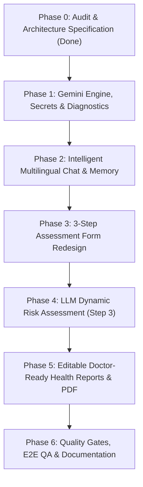

# Milestone 4.5 — AI Quality & Product Hardening Plan

**Project:** Health Companion AI  
**Author:** AI Engineering & Full-Stack Team  
**Status:** Completed (Phases 1-6 Verified, Tested & Committed — Commit `96e6144`)  
**Target Milestone:** M4.5 (Pre-M5 Hardening)

---

## 1. Executive Summary & Root Cause Analysis

### 1.1 The Problem
In production, user consultations and assessment reports are currently returning generic, hardcoded mock responses rather than intelligent, LLM-generated analysis. Furthermore:
- Life-threatening statements such as *"I have the last stage of cancer"* receive a generic reply with a misleading **Low Risk** badge.
- Greetings and user names (e.g. *"Assalamualaikum. My name is Huzaifa Ansari"*) are erroneously extracted and displayed as symptoms.
- Consultation titles are all uniformly titled *"New Health Con..."* without auto-titling.
- The health check form is simplistic and disjointed from the rich Lovable target designs (Images 4 & 5).
- Health reports are static summaries rather than personalized, interactive, and user-editable documents.

---

### 1.2 Root Cause Analysis & Concrete Code Evidence

#### Root Cause 1: Secret Variable Mismatch (`AI_API_KEY` vs `GEMINI_API_KEY`)
- **Evidence in Code:** In [`supabase/functions/_shared/aiAdapter.ts`](file:///d:/01_Career/01_Agentic%20AI/Health%20Companion%20AI/supabase/functions/_shared/aiAdapter.ts#L185-L191):
  ```typescript
  const provider = (providerOverride || Deno.env.get("AI_PROVIDER") || "gemini").toLowerCase();
  const apiKey = keyOverride || Deno.env.get("AI_API_KEY");

  if (!apiKey) {
    // If no API key configured on the server, return safe fallback
    return SAFE_FALLBACK_OUTPUT;
  }
  ```
  The Edge Function looks specifically for `Deno.env.get("AI_API_KEY")`. In standard Supabase environments, developers configure `GEMINI_API_KEY`. Because `AI_API_KEY` was missing, `apiKey` evaluated to `undefined`, immediately triggering `SAFE_FALLBACK_OUTPUT`.

#### Root Cause 2: Silent Fallback to Identical Hardcoded Mock
- **Evidence in Code:** Lines 23–35 of [`aiAdapter.ts`](file:///d:/01_Career/01_Agentic%20AI/Health%20Companion%20AI/supabase/functions/_shared/aiAdapter.ts#L23-L35) define:
  ```typescript
  export const SAFE_FALLBACK_OUTPUT: ValidatedConsultOutput = {
    reply:
      "Thank you for sharing your symptoms. To help provide you with the most relevant wellness guidance, could you tell me how long you've noticed this and whether it feels mild or more intense?",
    risk_level: "Low",
    emergency: false,
    suggested_replies: ["Started today", "A few days", "Over a week", "Mild intensity"],
    extracted: {
      symptoms: [],
      duration: "",
      intensity: "",
      lifestyle: "",
    },
  };
  ```
  Whenever `invokeLLM()` encounters a missing key, network timeout, rate limit, or invalid JSON, it silently swallows the error (lines 208–214) and returns `SAFE_FALLBACK_OUTPUT`.
- **Evidence from Image 1:** Every message sent by the user (including *"Assalamualaikum..."* and *"I have the last stage of cancer."*) receives this exact string verbatim, along with the exact suggestions chips (`Started today`, `A few days`, `Over a week`, `Mild intensity`) and a hardcoded `Low Risk` badge.

#### Root Cause 3: Fallback Symptom Extraction Slices First User Message
- **Evidence in Code:** In [`src/services/chatService.ts`](file:///d:/01_Career/01_Agentic%20AI/Health%20Companion%20AI/src/services/chatService.ts#L579-L586):
  ```typescript
  // Fallback if none extracted directly
  if (symptomsSet.size === 0) {
    if (userMessages.length > 0) {
      symptomsSet.add(userMessages[0].content.slice(0, 40));
    } else {
      symptomsSet.add("General wellness concern");
    }
  }
  ```
- **Evidence from Image 2:** Because `SAFE_FALLBACK_OUTPUT` returned an empty `symptoms: []`, `generateHealthSummary` blindly took `userMessages[0].content.slice(0, 40)` which was `"Assalamualaikum. My name is Huzaifa Ansari"`. The modal in Image 2 shows:
  > *"Based on your consultation, you reported experiencing Assalamualaikum. My name is Huzaifa Ansa. Your overall wellness risk indicator is categorized as Low."*
  with a green symptom tag reading `"Assalamualaikum. My name is Huzaifa Ansa"`.

#### Root Cause 4: Assessment Flow Never Called an LLM
- **Evidence in Code:** In [`src/pages/Assessment.tsx`](file:///d:/01_Career/01_Agentic%20AI/Health%20Companion%20AI/src/pages/Assessment.tsx#L57-L87):
  The assessment results (Step 3) are calculated purely client-side via a synchronous JS function `calculateAnalysis()` with static if-else checks (`if (symptomCount >= 3) riskLevel = "High"`).
  Meanwhile, the backend Edge Function [`supabase/functions/analyze-health/index.ts`](file:///d:/01_Career/01_Agentic%20AI/Health%20Companion%20AI/supabase/functions/analyze-health/index.ts#L49-L66) also had a comment `// AI Provider invocation can be performed with Deno.env.get("AI_API_KEY")` and returned hardcoded static strings without ever invoking an LLM.

#### Root Cause 5: Emergency Detection Omitted Severe/Terminal Distress
- **Evidence in Code:** [`src/lib/emergencyDetector.ts`](file:///d:/01_Career/01_Agentic%20AI/Health%20Companion%20AI/src/lib/emergencyDetector.ts) handles acute cardiac, stroke, respiratory, hemorrhage, syncope, and suicidal crisis, but lacks coverage for serious/terminal oncological diagnoses and high emotional distress (e.g. *"last stage of cancer"*, *"terminal illness"*). Furthermore, when not an acute emergency, `aiAdapter.ts` defaulted the risk level to `"Low"` rather than `"Not assessed"`, misleading the patient.

---

### 1.3 Image Audit & Comparison

| Image | Current State in Code | Target State (M4.5) |
| :--- | :--- | :--- |
| **Image 1: AI Chat Screen** | Silent fallback repeats identical greeting prompt; *"last stage of cancer"* gets `Low Risk`; sidebar sessions all titled `"New Health Con..."` or raw strings. | Real Gemini LLM responses in English or Roman Urdu; friendly formatting (emojis, sections); empathetic distress handling; risk badge only when evaluated; auto-generated session titles. |
| **Image 2: Health Report Modal** | Blind string slicing stores greetings as symptoms; report synthesis is truncated and generic. | LLM-driven structured summary with strict extraction filtering (ignoring greetings/names); personalized clinical questions and lifestyle recommendations. |
| **Image 3: Current Form (Step 2)** | Only 7 basic chips, simple sleep/water/activity inputs. Missing depth. | Replaced by comprehensive Lovable-grade assessment inputs (Image 4). |
| **Image 4: Target Form Design** | Lovable Step 2 design with structured lifestyle sections, toggle switches, harmful habit multi-selects. | Implement clean 3-step form: Step 1 (body basics, feet/inches, kg/lb toggle), Step 2 (rich symptoms list + custom text, habits, family history, diet, demo toggle). |
| **Image 5: Target Result Design** | Currently hardcoded text and static recommendation list. | Implement Image 5 visual hierarchy: prominent BMI card, personalized narrative summary, dynamic risk indicators (Medium/High only with rationales), structured recommendations, disclaimer. |

---

## 2. Phase-by-Phase Implementation Plan



---

### Phase 1: Gemini Engine, Secrets, Diagnostics & Error Visibility

**Goal:** Establish a robust, observable server-side Gemini integration with zero silent failures, proper secret handling, dynamic model selection, and an end-to-end diagnostic health check.

- **Files to Change:**
  - [`supabase/functions/_shared/aiAdapter.ts`](file:///d:/01_Career/01_Agentic%20AI/Health%20Companion%20AI/supabase/functions/_shared/aiAdapter.ts):
    - Support `GEMINI_API_KEY` (with fallback to `AI_API_KEY`).
    - Support `GEMINI_MODEL` (defaulting to `gemini-1.5-flash` or `gemini-2.0-flash`).
    - Remove silent fallback to `SAFE_FALLBACK_OUTPUT`. If the LLM call fails, throw a clear structured error: `AI_UNAVAILABLE`.
    - Enforce Zod validation on structured JSON output with 1 automatic retry on parse/schema error.
    - Set 15-second abort signal timeout.
  - [`supabase/functions/chat-consult/index.ts`](file:///d:/01_Career/01_Agentic%20AI/Health%20Companion%20AI/supabase/functions/chat-consult/index.ts):
    - Return explicit `503 Service Unavailable` with message `"AI is temporarily unavailable. Please retry."` when the LLM is down.
    - Add diagnostic query parameter/action (`?action=diagnose`) allowing authenticated users/admins to test LLM connectivity directly.
  - [`src/services/chatService.ts`](file:///d:/01_Career/01_Agentic%20AI/Health%20Companion%20AI/src/services/chatService.ts):
    - Remove client-side silent fallback that generates fake consultation replies.
    - Propagate server error to UI so the user sees a helpful retry banner.
    - Keep Demo mode explicitly labeled (`[Demo Mode - Simulated Guidance]`).
  - [`src/components/chat/MessageList.tsx`](file:///d:/01_Career/01_Agentic%20AI/Health%20Companion%20AI/src/components/chat/MessageList.tsx):
    - Display a clear "AI is temporarily unavailable — Click to Retry" card with a retry button.
- **Data / Schema Changes:** None (uses existing Edge Function environment).
- **Tests to Add:**
  - `aiAdapter.test.ts`: test key extraction (`GEMINI_API_KEY`), model selection, schema validation failure, and retry logic.
  - `chatService.test.ts`: test propagation of 503 error and retry trigger without swallowing errors.
- **Acceptance Criteria:**
  1. Edge function reads `GEMINI_API_KEY` from Supabase secrets.
  2. If the API key is invalid or Gemini is down, the UI shows a clear error message and a retry button (no generic fake text).
  3. Diagnostic test succeeds when key is present.
- **Manual Steps for User:**
  1. Open Supabase Dashboard -> Project Settings -> Edge Functions -> Secrets.
  2. Set `GEMINI_API_KEY = <your-google-ai-studio-key>`.
  3. Optional: Set `GEMINI_MODEL = gemini-1.5-flash` (or `gemini-2.0-flash`).

---

### Phase 2: Intelligent Multilingual Chat, Safety, Memory & Auto-Titling

**Goal:** Transform the consultation chatbot into a responsive, empathetic, and culturally aware health companion supporting English and Roman Urdu, with rolling chat memory, global profile context, extended safety for terminal/severe illness, and auto-generated session titles.

- **Files to Change:**
  - [`supabase/functions/_shared/prompts/consultPrompt.ts`](file:///d:/01_Career/01_Agentic%20AI/Health%20Companion%20AI/supabase/functions/_shared/prompts/consultPrompt.ts):
    - Instruct model to detect and reply in the user's language (English or Roman Urdu) in simple words.
    - Format replies cleanly with light emojis (🩺, 💧, ⚠️, ✅), short paragraphs, and bullet points.
    - Consultation flow: 
      1. Analyze symptoms (ask 1–2 follow-up questions only if necessary).
      2. Offer likely possibilities in cautious language ("Scabies is a likely possibility"), never confirmed diagnoses.
      3. Educate: what it is, causes, prevention, standard treatments, common symptoms.
      4. Next steps: recommended doctor specialty, specific questions for the physician, warning signs needing immediate care.
    - Medicine query handling: Explain general use, standard precautions, and side effects in helpful conversational tone; explicitly forbid dosing instructions and remind users to take medication only as prescribed by their doctor.
    - Strict requirement: Every response ends with ONE single-line non-diagnostic disclaimer.
  - [`src/lib/emergencyDetector.ts`](file:///d:/01_Career/01_Agentic%20AI/Health%20Companion%20AI/src/lib/emergencyDetector.ts) & [`supabase/functions/_shared/emergencyDetector.ts`](file:///d:/01_Career/01_Agentic%20AI/Health%20Companion%20AI/supabase/functions/_shared/emergencyDetector.ts):
    - Add a new category: `Critical/Terminal Distress & Severe Oncology` (e.g. *"last stage of cancer"*, *"terminal condition"*, *"stage 4"*, *"hospice"*).
    - Provide a calm, empathetic, and supportive reply focusing on palliative support and oncology care, omitting the generic "Low Risk" badge.
  - [`src/components/chat/MessageBubble.tsx`](file:///d:/01_Career/01_Agentic%20AI/Health%20Companion%20AI/src/components/chat/MessageBubble.tsx):
    - Only display a risk badge if the AI explicitly assessed a risk (`Low`, `Medium`, `High`). If unassessed or in early chat, display `"Not assessed"` or hide the badge.
  - [`supabase/functions/chat-consult/index.ts`](file:///d:/01_Career/01_Agentic%20AI/Health%20Companion%20AI/supabase/functions/chat-consult/index.ts) & [`src/services/chatService.ts`](file:///d:/01_Career/01_Agentic%20AI/Health%20Companion%20AI/src/services/chatService.ts):
    - **Chat Memory:** Send recent messages (last 6–8) + rolling summary of older messages.
    - **Global Memory:** Inject data-minimized health profile (`buildAiProfileContext`) respecting Privacy Center opt-ins.
    - **Title Generation:** On the first exchange, ask the LLM to output a concise 2–4 word title (e.g., *"Persistent Cough Consultation"* or *"Knee Pain & Stiffness"*), updating `chat_sessions.title`.
    - **Symptom Extraction Sanitization:** Filter out conversational pleasantries, names, and greetings (`"Assalamualaikum"`, `"Hello"`, `"My name is..."`) from extracted symptoms.
  - [`src/components/chat/AiMemoryDialog.tsx`](file:///d:/01_Career/01_Agentic%20AI/Health%20Companion%20AI/src/components/chat/AiMemoryDialog.tsx) (New Component):
    - Simple modal opened from chat header: "What the AI Knows About Me" showing active profile fields and privacy toggles.
- **Data / Schema Changes:** None (reuses `chat_sessions.title` and `chat_messages.metadata`).
- **Tests to Add:**
  - `emergencyDetector.test.ts`: Test detection of terminal illness phrases ("last stage of cancer", "stage 4 oncology").
  - `chatService.test.ts`: Test title auto-generation, greeting exclusion in symptom extraction, and Roman Urdu prompt handling.
- **Acceptance Criteria:**
  1. User messaging in Roman Urdu receives Roman Urdu responses.
  2. "Last stage of cancer" produces a supportive, compassionate response and does NOT show a "Low Risk" badge.
  3. Greetings are never recorded as symptoms in the summary.
  4. Sessions are given meaningful titles automatically.
  5. User can view "What the AI knows about me" from the chat interface.

---

### Phase 3: Health Risk Assessment Form Redesign (Steps 1 & 2)

**Goal:** Re-architect the assessment form to match the premium Lovable reference design (Image 4), rename all labels to "Health Risk Assessment" / "New Assessment", and capture comprehensive health, lifestyle, and substance habits.

- **Files to Change:**
  - Route and CTA renames:
    - Update navigation, buttons, and titles from "Start Health Check" / "New Check" to **"Health Risk Assessment"** / **"New Assessment"** across [`src/components/landing/Header.tsx`](file:///d:/01_Career/01_Agentic%20AI/Health%20Companion%20AI/src/components/landing/Header.tsx), [`src/pages/Dashboard.tsx`](file:///d:/01_Career/01_Agentic%20AI/Health%20Companion%20AI/src/pages/Dashboard.tsx), and [`src/pages/Assessment.tsx`](file:///d:/01_Career/01_Agentic%20AI/Health%20Companion%20AI/src/pages/Assessment.tsx).
  - [`src/pages/Assessment.tsx`](file:///d:/01_Career/01_Agentic%20AI/Health%20Companion%20AI/src/pages/Assessment.tsx):
    - **Step 1 — Body Basics:**
      - Age, Gender (Male, Female, Other, Prefer not to say).
      - Height in **feet and inches** (two select/input fields, converted to cm internally: `totalInches * 2.54`).
      - Weight in **kg**, with toggle for **lbs** (converted to kg internally: `lbs / 2.20462`).
      - Real-time BMI calculation with visual gauge/badge.
    - **Step 2 — Symptoms & Lifestyle (matching Image 4):**
      - Demo Mode toggle at the top right.
      - Scrollable multi-select symptom cards:
        - Frequent fatigue or tiredness
        - Recurring headaches
        - Shortness of breath
        - Chest pain or discomfort
        - Dizziness or lightheadedness
        - Excessive thirst
        - Frequent urination
        - Blurred vision
        - Joint pain or stiffness
        - Sleep problems / insomnia
        - High stress or anxiety
        - Digestive discomfort / bloating
        - *Optional free-text box for other symptoms.*
      - Lifestyle Factors:
        - Physical Activity Level (Sedentary, Light, Moderate, Active, Very Active).
        - Diet Type (Balanced, Poor/High processed, High sugar, High fat/oily, Vegetarian, Vegan).
        - Smoking toggle (Yes / No).
        - Other Harmful Substances / Habits multi-select:
          - Tobacco / Vaping / E-cigarettes
          - Nicotine pouches (e.g. ZYN, VELO)
          - Gutka
          - Chhalia / Supari
          - Paan
          - Naswar
          - Excess energy drinks / cold drinks
          - *Optional free-text box.*
        - Regular Alcohol Consumption toggle (Yes / No).
        - Family History of Chronic Diseases multi-select:
          - Diabetes
          - Heart disease / Cardiovascular
          - Hypertension (High BP)
          - Cancer
          - Asthma / Respiratory
          - Kidney disease
          - Thyroid disorder
          - *Optional free-text box.*
        - Sleep hours (3–14 hrs) and daily water intake (0.5–6 L).
  - [`src/services/healthService.ts`](file:///d:/01_Career/01_Agentic%20AI/Health%20Companion%20AI/src/services/healthService.ts):
    - Update `AssessmentRecord` typing to accommodate expanded lifestyle and substance habits safely in `lifestyle_data` JSONB.
- **Data / Schema Changes:**
  - `lifestyle_data` in `health_assessments` (already a JSONB column) stores the structured payload (`diet_type`, `smoking`, `harmful_substances`, `alcohol`, `family_history`, `custom_symptoms`). No breaking SQL migration required; fully backward-compatible.
- **Tests to Add:**
  - `healthService.test.ts`: Test feet/inches to cm conversion, lbs to kg conversion, BMI calculation, and validation ranges.
- **Acceptance Criteria:**
  1. All links and headers display "Health Risk Assessment" / "New Assessment".
  2. Height input uses feet and inches; weight supports kg/lbs toggle.
  3. Step 2 presents the full symptom list, habit selectors, and toggles matching Image 4.
  4. Demo mode toggle functions properly.

---

### Phase 4: LLM-Generated Dynamic Assessment Result (Step 3)

**Goal:** Connect Step 3 of the assessment to Gemini via the `analyze-health` Edge Function to produce a dynamic, personalized clinical risk report modeled after Image 5, showing only meaningful Medium and High risks with concise rationales.

- **Files to Change:**
  - [`supabase/functions/analyze-health/index.ts`](file:///d:/01_Career/01_Agentic%20AI/Health%20Companion%20AI/supabase/functions/analyze-health/index.ts):
    - Upgrade from static mock strings to server-side Gemini invocation via `_shared/aiAdapter.ts`.
    - Accept Step 1 & Step 2 comprehensive payload.
    - System prompt instructions:
      - Evaluate risk dynamically across broad health systems (metabolic, cardiovascular, respiratory, hepatic, renal, musculoskeletal, oncological, lifestyle).
      - Filter output: **Only return conditions evaluated as Medium or High risk.** Do NOT return low-risk conditions unless there are no medium/high risks (in which case return a positive wellness confirmation).
      - Include a 1-sentence rationale for each highlighted risk.
      - Return personalized lifestyle recommendations and standard non-diagnostic disclaimer.
      - Strict JSON output schema validated with Zod.
  - [`src/pages/Assessment.tsx`](file:///d:/01_Career/01_Agentic%20AI/Health%20Companion%20AI/src/pages/Assessment.tsx):
    - Implement Step 3 UI matching Image 5:
      - Stepper indicator (1 - 2 - 3, active on 3).
      - Large BMI hero card with category badge ("Underweight", "Normal", "Overweight", "Obesity") and disclaimer.
      - Personalized "Summary" card with narrative analysis.
      - Dynamic "Risk Indicators" grid: each card displays icon, condition name, risk badge (`Medium Risk` or `High Risk`), and rationale.
      - "Recommendations" card with clean checkmark list.
      - Medical safety warning banner.
      - Actions: "New Assessment" and "Go to Dashboard".
  - [`src/services/healthService.ts`](file:///d:/01_Career/01_Agentic%20AI/Health%20Companion%20AI/src/services/healthService.ts):
    - Implement `analyzeHealthAssessment()` calling `supabase.functions.invoke("analyze-health")`.
    - In Demo Mode, provide realistic simulated dynamic analysis.
- **Data / Schema Changes:**
  - Update `health_assessments.ai_summary` and `chat_summary_data` to store dynamic risks `{ condition: string, level: string, reason: string }[]`.
- **Tests to Add:**
  - `healthAnalysis.test.ts`: Test dynamic risk filtering (verifying low-risk conditions are excluded from the risk cards), schema parsing, and fallback on network timeout.
- **Acceptance Criteria:**
  1. Assessment Step 3 displays a personalized summary and dynamic risk cards (Image 5 style).
  2. Fixed 5-disease lists are eliminated in favor of AI-identified conditions.
  3. No artificial numeric percentages are shown; only `Medium` or `High` badges with reasons.
  4. Medical disclaimers remain prominently visible.

---

### Phase 5: Personalized, Editable Health Report, PDF & Doctor Share Link

**Goal:** Enable users to view a doctor-ready wellness report generated by the LLM from their consultation or assessment, edit every section directly with saved changes, and ensure edited data propagates to PDF downloads and doctor share links.

- **Files to Change:**
  - [`src/components/report/ReportView.tsx`](file:///d:/01_Career/01_Agentic%20AI/Health%20Companion%20AI/src/components/report/ReportView.tsx):
    - Add inline or modal editing for all report sections:
      - Chief complaints & timeline.
      - Lifestyle habits.
      - Risk evaluation & notes.
      - Recommendations.
      - Doctor discussion questions.
    - Display an `"Edited by you"` badge when custom edits are active.
  - [`src/pages/Report.tsx`](file:///d:/01_Career/01_Agentic%20AI/Health%20Companion%20AI/src/pages/Report.tsx):
    - Wire full report editing state and persistence.
    - Provide a "Reset to AI Original" option.
  - [`src/services/reportService.ts`](file:///d:/01_Career/01_Agentic%20AI/Health%20Companion%20AI/src/services/reportService.ts):
    - Implement `saveReportEdits(assessmentId, editedReportData, isDemo)`.
    - In Supabase, store `edited_report` in `health_assessments.chat_summary_data` (or dedicated column).
    - Update `fetchReportData()` to prioritize saved edits over raw generated defaults.
  - [`src/services/pdfService.ts`](file:///d:/01_Career/01_Agentic%20AI/Health%20Companion%20AI/src/services/pdfService.ts):
    - Verify that PDF generation uses the edited report data.
  - [`src/services/shareService.ts`](file:///d:/01_Career/01_Agentic%20AI/Health%20Companion%20AI/src/services/shareService.ts) & [`supabase/functions/create-share-link/index.ts`](file:///d:/01_Career/01_Agentic%20AI/Health%20Companion%20AI/supabase/functions/create-share-link/index.ts):
    - Verify that the immutable doctor share snapshot captures the user's edited content.
- **Data / Schema Changes:**
  - Persist edited report structure in `health_assessments.chat_summary_data->'edited_report'` or add `edited_report JSONB` migration.
- **Tests to Add:**
  - `reportEditing.test.ts`: Test saving report edits, loading edited vs original content, PDF generation with edited text, and share snapshot consistency.
- **Acceptance Criteria:**
  1. User can edit symptoms, notes, recommendations, and doctor questions.
  2. "Edited by you" badge is clearly visible when modifications exist.
  3. PDF export and shared doctor link render the edited content.

---

### Phase 6: Full QA, Quality Gates & Documentation

**Goal:** Run comprehensive automated tests, verify all quality gates pass (0 lint warnings/errors, 0 type errors, 100% test pass rate, clean production build), and update documentation.

- **Tasks:**
  - Run `npm run lint` -> 0 errors.
  - Run `npx tsc --noEmit` -> 0 errors.
  - Run `npx vitest run` -> 100% pass (baseline 161 tests + new tests).
  - Run `npm run build` -> production bundle succeeds cleanly.
  - Update `docs/ROADMAP.md` (documenting M4.5).
  - Update `README.md` with instructions for `GEMINI_API_KEY` and `GEMINI_MODEL`.
- **Acceptance Criteria:**
  - All four quality gates pass cleanly.
  - Working tree is clean and documented.

---

## 3. Manual Steps for the User

1. **Set Supabase Edge Function Secret:**
   - Go to your [Supabase Dashboard](https://supabase.com/dashboard) -> Select your project -> **Edge Functions** -> **Manage Secrets**.
   - Add a secret:
     - Name: `GEMINI_API_KEY`
     - Value: `<your-google-ai-studio-api-key>`
   - (Optional) Add model selection secret:
     - Name: `GEMINI_MODEL`
     - Value: `gemini-1.5-flash` (or `gemini-2.0-flash`)
2. **Deploy Updated Edge Functions (once code changes are made in Phase 1 & 4):**
   ```bash
   npx supabase functions deploy chat-consult --no-verify-jwt
   npx supabase functions deploy analyze-health --no-verify-jwt
   ```
   *(Note: The functions verify JWT tokens internally within their code).*

---

## 4. Verification Checkpoints

| Checkpoint | Gate Command | Expected Outcome |
| :--- | :--- | :--- |
| **Linting** | `npm run lint` | 0 errors |
| **Type Check** | `npx tsc --noEmit` | 0 errors |
| **Test Suite** | `npx vitest run` | All tests passing (161+ tests) |
| **Build** | `npm run build` | Successful production build |

---

*Plan created in compliance with project rules and medical safety guidelines. Ready for execution upon user confirmation ("go").*
