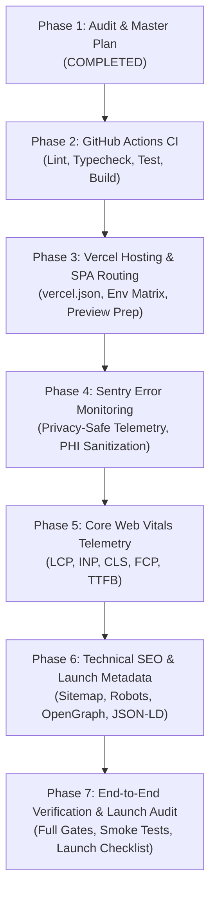

# Milestone 5: Production CI/CD, Deployment & Launch Readiness — Implementation Plan

> **Project:** Afiyat AI (عافیت AI) — AI-Powered Health & Wellness Assistant  
> **Repository:** `Huzaifa-Ansari-AI/Health-Companion-AI`  
> **Date:** October 2026  
> **Status:** Phase 1 Complete (Audit & Planning) — Awaiting User Approval to Implement Phase 2  
> **Primary Hosting:** Vercel  
> **CI/CD Quality Gate:** GitHub Actions  

---

## 1. Executive Summary & Audit Findings

### 1.1 Architecture & Stack Verification
- **Framework:** React 18.3.1 with TypeScript 5.8.3, bundled via Vite 5.4.19 (using `@vitejs/plugin-react-swc`).
- **Styling & UI:** Tailwind CSS 3.4.17 with shadcn/ui (Radix UI primitives), Lucide icons, and Plus Jakarta Sans typography.
- **State & Routing:** `react-router-dom` 6.30.1 (Single Page Application architecture) and `@tanstack/react-query` 5.83.0.
- **Backend & Cloud Services:** Supabase (PostgreSQL, Auth, RLS, Deno Edge Functions). Server-side Gemini AI integration (`analyze-health`, `chat-consult`, `generate-doctor-questions`).
- **Package Manager:** **`npm`** verified via lockfile `package-lock.json`.
- **Baseline Quality Gates (Empirically Verified):**
  - **Unit & Integration Tests:** 226 tests passing across 26 test suites (`vitest run`).
  - **TypeScript Typecheck:** 0 errors (`npx tsc -p tsconfig.app.json --noEmit`).
  - **ESLint:** 0 errors, 8 warnings on UI primitives (`eslint .`).
  - **Production Build:** Clean production bundle generated in ~35 seconds (`vite build`).

### 1.2 Gap Analysis Against Milestone 5 Objectives

| Objective | Requirement | Current State | Gap / Planned Solution |
| :--- | :--- | :--- | :--- |
| **5.1** | **Automated CI/CD** | No `.github` directory or workflows present. | Create `.github/workflows/ci.yml` running lint, typecheck, tests, and build on PRs & push to `main`. |
| **5.2** | **Vercel Hosting & SPA Routing** | No `vercel.json` present; direct navigation to client routes (e.g. `/assessment`, `/dashboard`) would 404. | Create `vercel.json` with SPA rewrite to `/index.html`, asset caching headers, and environment variable checklist. |
| **5.3** | **Monitoring & Observability** | Basic `ErrorBoundary` logs uncaught errors to `console.error`; no Sentry or telemetry SDK installed. | Install `@sentry/react`; configure privacy-first sanitization (strip PHI, health inputs, tokens; disable replays). |
| **5.4** | **Core Web Vitals** | No performance telemetry or Web Vitals package installed. | Install `web-vitals`; instrument LCP, INP, CLS, FCP, TTFB with zero-PHI telemetry. |
| **5.5** | **Launch SEO & Metadata** | `index.html` has relative OG images; `public/robots.txt` has no disallows for private routes; no `sitemap.xml`; no JSON-LD structured data. | Create `sitemap.xml`, update `robots.txt` with private route disallows, add canonical links, absolute OG URLs, and schema.org JSON-LD. |

---

## 2. Non-Negotiable Rules & Medical/Privacy Guardrails

1. **Medical Safety:**
   - Mandatory disclaimer: *"This is not a medical diagnosis. It is general wellness guidance. Please consult a qualified healthcare professional."* must remain prominent across all views.
   - Afiyat AI must NEVER be described in metadata, schema.org, or descriptions as a clinic, hospital, licensed medical provider, diagnostic tool, or doctor replacement.
2. **Telemetry Privacy & PHI Protection:**
   - Sentry and Web Vitals telemetry MUST NEVER collect:
     - Health assessment responses, BMI metrics, or symptoms
     - AI chat messages or consultation summaries
     - Auth tokens, session IDs, or password values
     - Expiring share tokens from URLs (`/shared/:token`)
   - Session Replay is strictly **DISABLED** (`replaysSessionSampleRate: 0`, `replaysOnErrorSampleRate: 0`).
   - Sentry `sendDefaultPii: false` with explicit `beforeSend` sanitization.
3. **Secret Protection:**
   - Client bundles only receive public variables (`VITE_SUPABASE_URL`, `VITE_SUPABASE_ANON_KEY`, `VITE_SENTRY_DSN`, `VITE_APP_URL`).
   - Server secrets (`SUPABASE_SERVICE_ROLE_KEY`, `GEMINI_API_KEY`) remain strictly within Supabase Edge Function secrets.
4. **Preservation of Existing Code:**
   - Zero modifications to health algorithms, BMI logic, offline deterministic rules, or database schemas.

---

## 3. Seven-Phase Sequential Implementation Plan



---

### Phase 1 — Complete Audit and Implementation Planning (Current Phase)
- **Status:** **Completed**
- **Deliverables:**
  - Comprehensive codebase audit, stack confirmation, and dependency inspection.
  - Creation of [docs/MILESTONE_5_IMPLEMENTATION_PLAN.md](file:///d:/01_Career/01_Agentic%20AI/Health%20Companion%20AI/docs/MILESTONE_5_IMPLEMENTATION_PLAN.md).
- **Quality Gates:** 226 unit tests passing, clean typecheck, clean build.

---

### Phase 2 — GitHub Actions CI Quality Gates (Completed & Verified)
- **Objective:** Establish automated quality gates ensuring no broken code or regression can merge into `main`.
- **Files to Create / Modify:**
  - `.github/workflows/ci.yml` *(New)*
  - `package.json` *(Add `"typecheck": "tsc -p tsconfig.app.json --noEmit"` script)*
- **Implementation Details:**
  - Trigger on `pull_request: branches: [main]` and `push: branches: [main]`.
  - Minimal read-only permissions: `permissions: { contents: read }`.
  - Node.js LTS (v20) with npm cache (`cache: 'npm'`).
  - Strict step order:
    1. `npm ci`
    2. `npm run lint`
    3. `npm run typecheck`
    4. `npm run test`
    5. `npm run build` (with fallback dummy `VITE_SUPABASE_URL` / `ANON_KEY` to prevent build failures in isolated PR runners).
- **Testing & Verification:**
  - Validate workflow syntax locally with YAML schema validator.
  - Test `npm run typecheck`, `npm run lint`, `npm run test`, and `npm run build` locally in exact CI execution sequence.
- **Rollback:** Delete or disable `.github/workflows/ci.yml`.

---

### Phase 3 — Vercel Hosting & Preview Deployment Readiness (Completed & Verified)
- **Objective:** Configure Vercel hosting rules, SPA route rewrites, static caching headers, and environment variable readiness.
- **Files to Create / Modify:**
  - `vercel.json` *(New)*
  - `.env.example` *(Update with Milestone 5 variables)*
  - `docs/DEPLOYMENT_GUIDE.md` *(New step-by-step guide for Vercel connection & Supabase URL configuration)*
- **Implementation Details:**
  - Add `vercel.json`:
    - Rewrite `/(.*)` to `/index.html` to support deep SPA routes (`/assessment`, `/dashboard`, `/reports/:id`, `/shared/:token`).
    - Cache headers for `/assets/(.*)` (`public, max-age=31536000, immutable`).
  - Document complete Environment Variable Matrix for Vercel (Development, Preview, Production).
  - Detail Supabase Auth URL Configuration requirements (Site URL & Redirect URLs for preview and custom domains).
- **Testing & Verification:**
  - Verify local production preview with `npm run build` and `npm run preview`.
  - Test deep route refreshes on `/assessment` and `/dashboard`.

---

### Phase 4 — Sentry Error Monitoring with PHI Sanitization (Completed & Verified)
- **Objective:** Add real-time error tracking and crash reporting with strict privacy controls preventing sensitive health data capture.
- **Dependencies:** `@sentry/react`.
- **Files to Create / Modify:**
  - `src/lib/sentry.ts` *(New: Sentry initialization & sanitization logic)*
  - `src/main.tsx` *(Initialize Sentry before React mounts)*
  - `src/components/common/ErrorBoundary.tsx` *(Forward caught exceptions to Sentry)*
  - `src/lib/sentry.test.ts` *(New: Unit tests verifying PHI sanitization and disabled state)*
- **Privacy & PHI Protection Safeguards:**
  - Sentry only activates when `VITE_SENTRY_DSN` is present and `import.meta.env.PROD` is true.
  - `sendDefaultPii: false`.
  - `replaysSessionSampleRate: 0` & `replaysOnErrorSampleRate: 0` (Session Replay disabled).
  - `beforeSend(event)` sanitization:
    - Strips query parameters and route parameters containing tokens (e.g. `/shared/[token]` replaced with `/shared/:token`).
    - Removes `event.request.data`, `event.user.ip_address`, and form input values.
    - Filters out user symptoms, habits, and chat content from breadcrumbs.
- **Testing & Verification:**
  - Unit tests asserting `beforeSend` strips query params, tokens, and sensitive strings.
  - Controlled test error triggered only in development mode via debug flag.

---

### Phase 5 — Core Web Vitals & Performance Telemetry (Completed & Verified)
- **Objective:** Capture real-user experience metrics (LCP, INP, CLS, FCP, TTFB) without collecting sensitive personal data or adding heavy dependencies.
- **Dependencies:** `web-vitals` (standard Google Chrome library).
- **Files to Create / Modify:**
  - `src/lib/vitals.ts` *(New: Web Vitals instrumentation & reporting handler)*
  - `src/main.tsx` *(Register metrics reporting)*
  - `src/lib/vitals.test.ts` *(New: Unit tests verifying safe payload construction)*
- **Implementation Details:**
  - Capture `onLCP`, `onINP`, `onCLS`, `onFCP`, `onTTFB`.
  - Non-blocking: uses `requestIdleCallback` or `navigator.sendBeacon` if reporting to an endpoint.
  - Safe payload: strictly includes `{ name, value, rating, delta, id, navigationType }`. Zero health or personal data.
  - Console reporting in development; supports Sentry tracing or custom beacon in production if configured.
- **Testing & Verification:**
  - Unit tests for payload formatting and threshold ratings.

---

### Phase 6 — Technical SEO, Open Graph & Launch Landing Page (Completed & Verified)
- **Objective:** Ensure Afiyat AI has production-ready metadata, social cards, search engine directives, and structured data with honest, non-diagnostic claims.
- **Files to Create / Modify:**
  - `index.html` *(Update title, descriptions, canonical links, Open Graph, Twitter cards, JSON-LD)*
  - `public/robots.txt` *(Add private route disallows & sitemap link)*
  - `public/sitemap.xml` *(New: Valid XML listing canonical public URLs)*
  - `src/components/landing/Header.tsx` & `Footer.tsx` *(Verify branding & legal/disclaimer links)*
- **Implementation Details:**
  - **Meta Tags:** Proper title, description, viewport, theme-color, and canonical URL.
  - **Open Graph:** Absolute image URLs pointing to official Afiyat logo asset.
  - **Robots.txt:**
    ```text
    User-agent: *
    Allow: /
    Disallow: /dashboard
    Disallow: /assessment
    Disallow: /chat
    Disallow: /checkin
    Disallow: /trends
    Disallow: /profile
    Disallow: /reports/
    Disallow: /shared/
    Disallow: /auth

    Sitemap: https://afiyatai.com/sitemap.xml
    ```
  - **Sitemap.xml:** Lists only public canonical route (`/`).
  - **JSON-LD Structured Data:**
    - `WebSite` & `SoftwareApplication` (category: HealthApplication, Health & Fitness).
    - Clear non-diagnostic disclaimer in description.
- **Testing & Verification:**
  - XML syntax validation for `sitemap.xml`.
  - Structured data validation against schema.org specifications.

---

### Phase 7 — Launch Readiness, End-to-End Verification & Audit (Completed & Verified)
- **Objective:** Comprehensive sign-off, end-to-end smoke testing, verification across all quality gates, and launch readiness checklist.
- **Files to Modify:**
  - `docs/ROADMAP.md` *(Update Milestone 5 checkboxes)*
  - `docs/MILESTONE_5_IMPLEMENTATION_PLAN.md` *(Mark all phases complete)*
  - `docs/DEPLOYMENT_GUIDE.md` *(Finalize production launch steps)*
- **Tasks:**
  1. Full clean execution of all quality gates (`npm run lint`, `npm run typecheck`, `npm run test`, `npm run build`).
  2. Verify zero secrets in Git status or history.
  3. Validate Vercel SPA routing and preview readiness.
  4. Provide pre-launch checklist for domain verification, DNS records, and Supabase URL configuration.

---

## 4. Environment Variables & Secrets Matrix

| Variable Name | Environment | Exposure | Purpose |
| :--- | :--- | :--- | :--- |
| `VITE_SUPABASE_URL` | Dev / Preview / Prod | **Public** (Client) | Supabase project API URL. |
| `VITE_SUPABASE_ANON_KEY` | Dev / Preview / Prod | **Public** (Client) | Supabase anonymous API key (enforces RLS). |
| `VITE_SENTRY_DSN` | Preview / Prod | **Public** (Client) | Sentry project ingestion DSN. |
| `VITE_APP_URL` | Preview / Prod | **Public** (Client) | Base URL for canonical tags and social shares. |
| `GEMINI_API_KEY` | Supabase Cloud | **Secret** (Server-only) | Managed via Supabase Vault/Secrets. Never in Vercel. |
| `SUPABASE_SERVICE_ROLE_KEY` | Supabase Cloud | **Secret** (Server-only) | Managed via Supabase Secrets. Never in client or Vercel. |

---

## 5. Required Manual User Actions (Summary)

The following actions cannot be performed directly from code and will require your input in the relevant dashboards:

1. **Vercel Project Setup (Phase 3):**
   - Connect repository `Huzaifa-Ansari-AI/Health-Companion-AI` in the Vercel Dashboard.
   - Configure project environment variables (`VITE_SUPABASE_URL`, `VITE_SUPABASE_ANON_KEY`, `VITE_SENTRY_DSN`, `VITE_APP_URL`).
2. **Supabase URL Configuration (Phase 3):**
   - In Supabase Dashboard -> Authentication -> URL Configuration:
     - Set **Site URL** to production domain (e.g. `https://afiyatai.com` or `https://health-companion-ai.vercel.app`).
     - Add Redirect URLs: `https://*.vercel.app/**` (for preview deployments).
3. **Sentry Project Creation (Phase 4):**
   - Create a project on [sentry.io](https://sentry.io) (React platform) to obtain your `VITE_SENTRY_DSN`.
4. **Custom Domain & DNS (Phase 7 / Launch):**
   - Add custom domain in Vercel Project Settings -> Domains and configure DNS CNAME / A records at domain registrar.

---

## 6. Risk Assessment & Mitigations

| Risk | Impact | Mitigation |
| :--- | :--- | :--- |
| **Direct URL refreshes return 404 on Vercel** | High | `vercel.json` rewrite rule `/(.*) -> /index.html`. |
| **Sensitive health data captured in telemetry** | Critical | Strict Sentry sanitization: disable Session Replay, sanitize URLs, drop inputs/chat content. |
| **CI build fails on missing env variables** | Medium | Provide fallback dummy credentials in CI build step or `.env.example`. |
| **Private user data exposed in sitemap/SEO** | Critical | Strict `robots.txt` disallows for `/dashboard`, `/reports`, `/assessment`, `/chat`, `/profile`. |
| **Production build regression or bundle bloat** | Medium | Quality gate enforces `npm run build` with size checking and code-splitting validation. |

---

## 7. Phase Completion Checklist

- [x] **Phase 1:** Complete Audit and Master Implementation Plan *(Completed)*
- [x] **Phase 2:** GitHub Actions CI Quality Gates *(Completed & Verified)*
- [x] **Phase 3:** Vercel Hosting & Preview Deployment Readiness *(Completed & Verified)*
- [ ] **Phase 4:** Sentry Error Monitoring with PHI Sanitization
- [ ] **Phase 5:** Core Web Vitals & Performance Telemetry
- [ ] **Phase 6:** Technical SEO, Open Graph & Launch Landing Page
- [ ] **Phase 7:** Launch Readiness, End-to-End Verification & Audit
