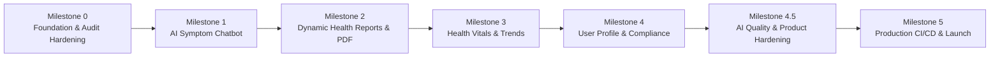

# Health Companion AI — Startup Development Roadmap & Milestones

**Mission:** Build a production-grade, patient-friendly AI Health & Wellness Companion that solves real-world health awareness challenges through conversational AI, structured risk assessments, and actionable lifestyle intelligence.

---

## Roadmap Overview

---

## Milestone 0: Foundation Hardening, Debugging & Delivery Readiness
> **Goal:** Ensure the current codebase is 100% bug-free, fully responsive, cleanly tested, and ready for high-velocity feature development.

- [x] **0.1 UX & Navigation Consistency:**
  - Verify all CTAs across Landing Page (`Header`, `Hero`, `Features`, `Footer`) route dynamically based on auth state (direct to `/assessment` or `/dashboard` if logged in, `/auth` if guest).
  - Polish mobile drawer/navbar toggle and responsive layout on all screen sizes.
- [x] **0.2 Robust Error Handling & Boundaries:**
  - Implement a global React Error Boundary with fallback UI so the app never shows a blank white screen on unexpected errors.
  - Implement network retry and user-friendly toast notifications for Supabase connection hiccups.
- [x] **0.3 Automated Testing Foundation:**
  - Set up Vitest and React Testing Library.
  - Add unit tests for core utilities (`calculateBMI`, risk indicator logic, auth state helpers).
- [x] **0.4 Code Cleanliness & Production Verification:**
  - Clean build output, verify strict TypeScript checks (`tsc --noEmit`), zero ESLint warnings/errors.
  - Commit milestone completion to GitHub with a clean semantic tag.

---

## Milestone 1: Interactive AI Symptom Consultation Chatbot
> **Goal:** Empower users to chat naturally about their symptoms, concerns, and health questions, receiving empathetic, safe, and structured AI guidance.

- [x] **1.1 Chatbot Interface & Experience:**
  - Full-screen / drawer conversational interface with smooth micro-animations.
  - Typing indicator, quick-reply suggestion chips (e.g., "Frequent headaches", "Sleep issues", "Digestive problems").
  - Persistent chat history per user saved in Supabase.
- [x] **1.2 Conversational AI Engine (Gemini / OpenAI Integration):**
  - Multi-turn conversation maintaining contextual symptom discovery.
  - Guardrails & Safety Filters: Emergency detection (e.g. chest pain, stroke symptoms triggers immediate emergency warning + 911/emergency dispatch advice).
  - Categorical risk determination (Low / Medium / High).
- [x] **1.3 Automated Consultation Report Generation:**
  - AI extracts reported symptoms, duration, intensity, and lifestyle factors from the chat.
  - Synthesizes a structured "Health Assessment Summary" ready for review or export.
- [x] **1.4 Direct Database Sync:**
  - Automatically saves the synthesized assessment into the user's Supabase dashboard.

---

## Milestone 2: Dynamic Health Reports & PDF Export
> **Goal:** Provide patients and doctors with beautifully formatted, professional health summaries they can view, print, download, or share.

- [x] **2.1 Standardized Report Template:**
  - Patient demographics (age, gender, BMI).
  - Chief complaints / symptoms timeline.
  - Lifestyle factors (sleep, hydration, activity score).
  - Categorical Risk Assessment with clear disclaimers.
  - Doctor discussion points (suggested questions the patient can ask their physician).
- [x] **2.2 High-Fidelity PDF Generator:**
  - Client-side vector PDF (`pdf-lib`) with clean typography, branded headers, page numbers, selectable text, and QR code verification (`qrcode`).
- [x] **2.3 Secure Shareable Links:**
  - Temporary read-only access link with expiration (24h, 3d, 7d), token hashing (SHA-256), immutable snapshots, and privacy toggles.

---

## Milestone 3: Health Vitals Analytics & Longitudinal Tracking
> **Goal:** Transform single-use assessments into a continuous health journey with trend tracking and habit adherence.

- [x] **3.1 Visual Trend Charts (`Recharts`):**
  - BMI history progression graph over weeks/months.
  - Sleep duration vs. reported fatigue correlation.
  - Hydration and physical activity tracking.
- [x] **3.2 Daily Habit & Wellness Check-in:**
  - 30-second daily check-in (mood, sleep hours, water intake, daily energy score).
  - Streak tracking and milestone achievements.

---

## Milestone 4: Patient Profile, Personalization & Privacy Readiness
> **Goal:** Medical history context, profile customization, and healthcare data privacy standards.

- [x] **4.1 Comprehensive Health Profile:**
  - Patient demographics (age, gender, timezone).
  - Known allergies with severity levels (mild, moderate, severe).
  - Health conditions with status (active, managed, past).
  - Family health history tracking.
  - Current medications (background context only, strictly non-prescriptive, no dosage changes).
  - Profile completeness meter (0-100%) with actionable next steps.
  - AI data minimization filter (`buildAiProfileContext`) mapping exact age to brackets and stripping identifiers.
- [x] **4.2 Data Privacy & Security (Privacy-Focused, Aligned with Good Privacy Practices):**
  - "Download My Data" full machine-readable JSON archive export.
  - Complete account & data deletion flow with explicit two-step confirmation (`DELETE MY DATA`) and Supabase CASCADE cleanup.
  - Granular opt-in privacy toggles (5 distinct consents, default OFF) with append-only audit trail log.
  - Strict owner-only Row-Level Security (RLS) on all 8 health profile and privacy tables.

---

## Milestone 4.5: AI Quality & Product Hardening (Gemini LLM, Assessment Redesign & Editable Reports)
> **Goal:** Upgrade the consultation engine, redesign the 3-step assessment (Lovable Reference Images 4 & 5), and provide doctor-ready editable health summaries prior to production launch.

- [x] **4.5.1 Robust Gemini Integration & Diagnostics:**
  - Standardized on Google AI Studio secret `GEMINI_API_KEY` with fallback to `GEMINI_MODEL` (e.g. `gemini-1.5-flash`).
  - Added in-app AI Diagnostics Dialog (`AiDiagnosticDialog.tsx`) with real-time ping and model latency checks.
  - Removed silent fake fallbacks; explicit, honest error propagation.
- [x] **4.5.2 Multilingual AI Consultation Engine (English + Roman Urdu):**
  - Upgraded consultation prompt (`consultPrompt.ts`) with Roman Urdu & English auto-detection, light emojis, and 4-step consultative flow.
  - Critical oncology & palliative distress interception with empathetic specialized support.
  - Automatic conversation titling (`suggested_title`) and greeting sanitization from extracted symptoms.
  - Rolling conversation memory (up to 16 messages) + AI Memory Dialog (`AiMemoryDialog.tsx`).
- [x] **4.5.3 3-Step Health Risk Assessment Form Redesign:**
  - Renamed all CTAs to "Health Risk Assessment" / "New Assessment".
  - **Step 1 (Body Basics):** Height in feet/inches with live cm conversion; weight with kg/lbs toggle; real-time BMI gauge.
  - **Step 2 (Symptoms & Lifestyle - Image 4):** 12 multi-select symptoms, habit selectors (smoking, alcohol, regional oral substances like Gutka, Chhalia, Paan, Naswar, VELO/ZYN, energy drinks), family history chips, sleep/water sliders.
- [x] **4.5.4 Dynamic Risk Assessment Result (Step 3 - Image 5):**
  - Connected `analyze-health` Edge Function to Gemini with structured Zod output validation.
  - Dynamic risk indicators grid displaying only Medium and High risks with concise 1-sentence rationales tied directly to user inputs (or 1 positive Low Risk card if all clear).
  - High-impact BMI hero card, personalized summary card, and actionable wellness steps.
- [x] **4.5.5 Doctor-Ready Editable Health Reports & PDF Sync:**
  - `EditReportDialog` allows patients to refine chief complaints, symptoms timeline, vitals, observations, and doctor discussion points.
  - "Edited by you" badge on reports and PDF exports.
  - Full propagation of customized edits to vector PDF downloads (`pdfService.ts`) and expiring doctor share links (`shareService.ts`).
  - Single-click "Reset to AI Original" option.
- [x] **4.5.6 Health Assessment Improvements, Offline Mode & Report Management:**
  - **Honest Offline Mode Labeling:** Renamed Demo Mode switch to "Offline Mode" (*Deterministic • Rule-Based*), hiding custom free-text inputs in favor of structured indicators and adding prominent non-AI banners to review and report views.
  - **Enhanced BMI Categorization:** Integrated `Severe Thinness (<16.0)` with red visual treatment matching Obesity, across a 5-column spectrum with numerical ranges stacked underneath category labels.
  - **Weight Input Backspace Bug Fix:** Replaced string-to-number coercions with a controlled string state allowing complete field clearing without getting stuck on digit `1`.
  - **Multi-Entry Custom Tag Inputs:** Replaced single-line inputs with dynamic tag systems supporting Enter key, `+` button, duplicate prevention, and individual chip removals for symptoms, habits, and family conditions.
  - **Database Persistence Disentanglement:** Ensured authenticated users saving offline assessments persist directly to Supabase `public.health_assessments` with `assessment_mode = "offline"`.
  - **Dashboard Report Deletion:** Added accessible `AlertDialog` confirmation modal and `deleteAssessment` service with automatic cascade cleanup of expired/active shared report links.

---

## Milestone 5: Production CI/CD, Deployment & Startup Launch
> **Goal:** Deploy to global edge CDN with automated testing, error tracking, and custom domain setup.

- [x] **5.1 Automated CI/CD Pipeline (Workflow Implemented & Locally Verified):**
  - GitHub Actions workflow (`.github/workflows/ci.yml`) running lint, typecheck, unit tests, and production build on every pull request and push to `main`.
  - Added `"typecheck": "tsc -p tsconfig.app.json --noEmit"` to `package.json` scripts; local verification matrix clean.
- [x] **5.2 Edge Production Hosting (Vercel Configuration & SPA Routing Ready):**
  - Configured `vercel.json` with SPA routing rewrites (`/(.*) -> /index.html`) and static asset cache headers.
  - Documented environment variable matrix (`.env.example`) and created comprehensive [DEPLOYMENT_GUIDE.md](file:///d:/01_Career/01_Agentic%20AI/Health%20Companion%20AI/docs/DEPLOYMENT_GUIDE.md) covering Supabase Auth redirect URLs and domain linking.
- [x] **5.3 Monitoring & Observability:**
  - [x] Sentry error monitoring integration with strict PHI sanitization & session replay disabled.
  - [x] Core Web Vitals telemetry (LCP, INP, CLS, FCP, TTFB) via `web-vitals` with privacy sanitization.
- [x] **5.4 Launch Readiness & Marketing Landing:**
  - Technical SEO, canonical URLs, robots.txt private route disallows, sitemap.xml, dynamic OpenGraph/Twitter social cards, and Schema.org health structured data.
- [x] **5.5 End-to-End Verification & Launch Audit:**
  - Full clean execution across all quality gates (typecheck 0 errors, 243 passing tests, 0 lint errors, production build verified).
  - Zero secrets in repository; strict medical disclaimer compliance and PHI sanitization verified.
